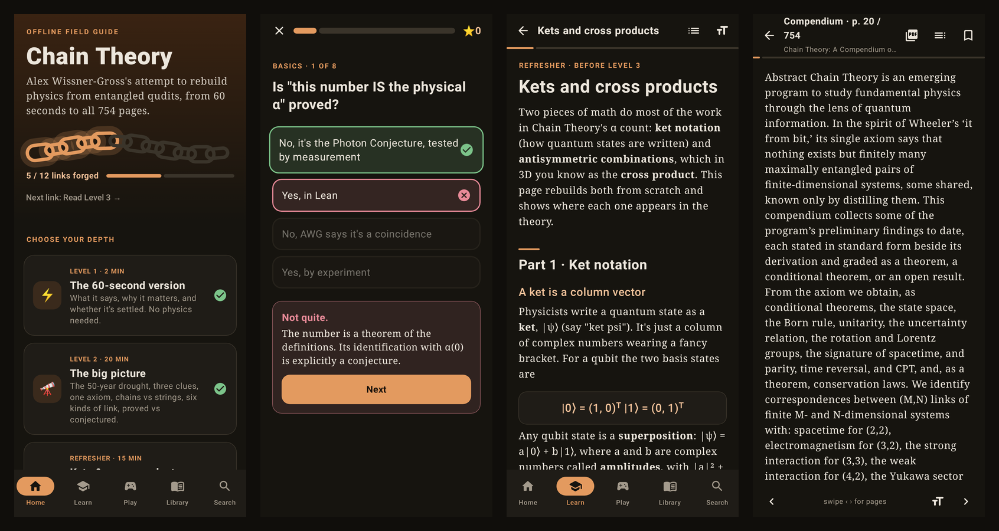
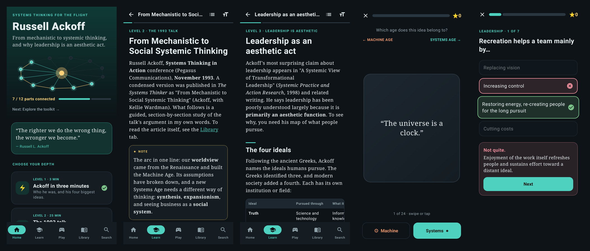
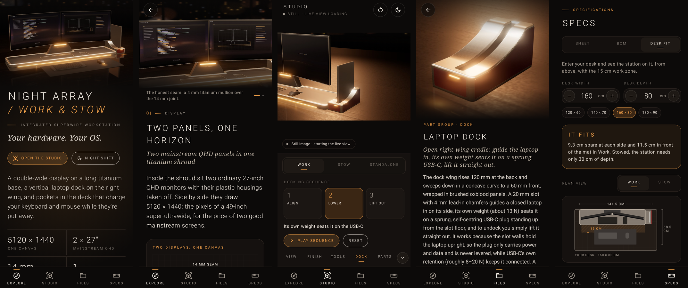

# NatesApps

A collection of small, self-contained apps. Each app lives in its own top-level directory with its own README, source, and build instructions.

## Apps

### [Chain Theory Explorer](chain-theory/)

An offline guide to Alex Wissner-Gross's **Chain Theory** (October 2026), his attempt to rebuild fundamental physics from networks of entangled qudits. It covers everything from a 60-second summary to the full 754-page compendium.



- **Native Android app** (Kotlin + Jetpack Compose), fully offline: layered explainers, a kets & cross products refresher, quizzes and flashcards, an α calculator, and a swipeable reader with native PDF rendering and full-text search.
- **Single-file web version**: the same content in one HTML file that works offline in any browser.
- **Install:** download [`chain-theory/ChainTheory.apk`](chain-theory/ChainTheory.apk) on an Android phone and open it. Allow installs from unknown sources when prompted.

### [Ackoff: Systems Thinking for the Flight](ackoff/)

A guide to **Russell Ackoff**: his 1993 talk *From Mechanistic to Social Systemic Thinking*, and his claim that leadership is an aesthetic act.



- **Native Android app**, fully offline: five levels (from a 3-minute intro to hands-on exercises), a section-by-section study guide to the talk, quizzes, flashcards, a "Machine or Systems?" swipe game, search, and a library that imports PDFs for offline reading.
- **Install:** download [`ackoff/Ackoff.apk`](ackoff/Ackoff.apk) on an Android phone and open it.

### [Night Array: Work & Stow](night-array/)

A concept desk battle station you can explore: two 27" QHD monitors in one titanium shroud with an honest seam, a long titanium base with pockets that charge your keyboard and mouse wirelessly, and a vertical laptop dock on the right wing.



- **Native Android app** (Kotlin + Jetpack Compose) with a **live CAD renderer** (three.js, fully offline). It has PBR, CAD, X-ray and blueprint styles, animated Work / Stow / Standalone modes, the docking sequence, explode, section cuts, dimensions and tap-to-inspect parts.
- **Real CAD files** from a parametric CadQuery model: a STEP assembly, STEP and STL per part group, GLB, engineering drawing sheets (SVG) and DXF outlines. You can share or save every file from the app.
- **Build it yourself:** a verified, priced [shopping list](night-array/kit/BOM.md) of real parts (screens, dock, power, keyboard, mouse, wireless chargers, steel), also in the app.
- **Install:** download [`night-array/NightArray.apk`](night-array/NightArray.apk) on an Android phone and open it.

## Repository layout

```
<app-name>/          one directory per app
  README.md          what it is, how to install, how to build
  ...                source, assets, prebuilt artifacts
```

To add an app, create a new top-level directory with its own README, then add an entry under **Apps** above.
