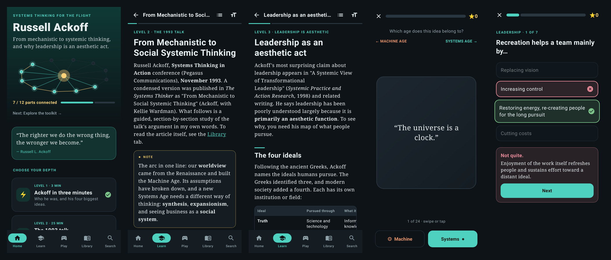

# Ackoff: Systems Thinking for the Flight

An offline Android app for learning **Russell L. Ackoff's** systems thinking. It focuses on his November 1993 talk *From Mechanistic to Social Systemic Thinking* and on his idea that **leadership is primarily an aesthetic function**.



## What's inside

- **Level 1, Ackoff in three minutes:** who he was and his four biggest ideas.
- **Level 2, The 1993 talk:** a section-by-section study guide to *From Mechanistic to Social Systemic Thinking* (Systems Thinking in Action conference, Nov 1993). It covers the Renaissance roots of the Machine Age, analysis vs synthesis, expansionism and producer–product, business as a social system, and automation. Each section has study questions.
- **Level 3, Leadership is aesthetic:** the four ideals (truth, plenty, the good, beauty), creation and recreation, leader vs manager vs administrator, transformational leadership, and an aesthetic audit of your own leadership.
- **Level 4, The toolkit:** kinds of systems, messes, absolve/resolve/solve/dissolve, idealized design, interactive planning, DIKW, efficiency vs effectiveness.
- **Level 5, Use it on Monday:** five notebook exercises.
- **Play:** four quiz decks, glossary flashcards, and **Machine or Systems?**, a swipe game that sorts ideas into the age they belong to. Progress lights up the parts of an animated system on the home screen.
- **Library:** import any PDF, such as the published article version of the talk, and read it offline with pinch-zoom.
- **Search** across the whole guide and glossary.

## About the speech text

No full transcript of the 1993 talk has been published. A condensed article version, "From Mechanistic to Social Systemic Thinking" (Ackoff, with Kellie Wardman), appears in *The Systems Thinker* and is copyrighted. It is **not bundled**. Download its PDF from thesystemsthinker.com on your phone and tap **Library → Import PDF**. The app keeps its own copy for offline reading.

Everything else is an original study guide that summarizes and paraphrases Ackoff's ideas. Direct quotations are marked as such.

## Install

Download [`Ackoff.apk`](Ackoff.apk) on an Android phone (Android 8.0+), open it, and allow installs from that source when prompted. It's signed with a debug key, so Play Protect may warn that the developer is unknown.

## Layout

```
ackoff/
  Ackoff.apk               prebuilt Android app
  content/content.html     all guide text, quizzes, glossary and swipe cards (single source)
  android/                 Kotlin + Jetpack Compose app
    tools/make_assets.py   converts content.html → app/src/main/assets/content.json
  docs/screenshots.png
```

## Build

```bash
python3 ackoff/android/tools/make_assets.py       # needs node
cd ackoff/android
gradle assembleRelease                             # → app/build/outputs/apk/release/app-release.apk
gradle testDebugUnitTest                           # Robolectric tests of every screen + screenshots
```

Requires JDK 21, Gradle 8.14 and the Android SDK (platform 36, build-tools 36). Put the SDK path in `android/local.properties`.
