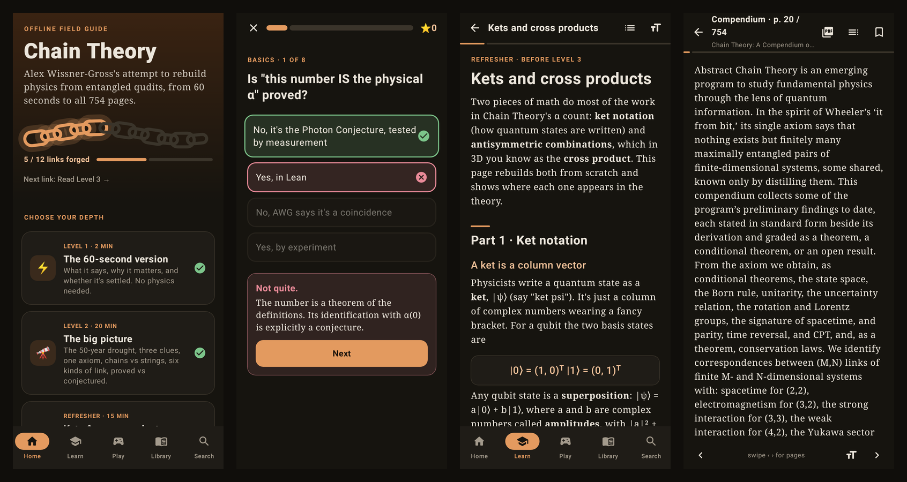

# Chain Theory Explorer

An offline app for exploring Alex Wissner-Gross's **Chain Theory** (October 2026). It works on several levels, from a 60-second summary to the full 754-page compendium, and needs no internet once installed.



## What's inside

- **Levels 1–3:** the 60-second version, the big picture (clues, the axiom, six genres of link, what's proved vs conjectured), and the math of the α count.
- **Refresher:** ket notation and the cross product, tied to where each appears in the theory.
- **Compendium map:** all sixteen Parts with their theorem / conditional / open counts.
- **Play:** four quiz decks and glossary flashcards, plus a "chain" of 12 progress links.
- **α calculator:** change the counts and weights of the formula and watch 1/α move against the measured value.
- **Library:** the full text of the intro talk, the alpha Letter and the compendium, with contents, bookmarks, resume, and the original PDF pages (pinch to zoom).
- **Search:** across the guide and all three documents.

## Website

The browser port lives at [`web/chain-theory/`](../web/chain-theory/) in this repository (not in `chain-theory/web/`, which is still the single-file offline build). Install, test, and production build:

```bash
cd web/chain-theory
npm install
npm test
npm run build          # static site in dist/
```

To deploy that site on Vercel, use this repository with:

| Setting | Value |
| --- | --- |
| Root directory | `web/chain-theory` |
| Framework preset | Vite |
| Install command | `npm install` |
| Build command | `npm run build` |
| Output directory | `dist` |
| Node.js version | 22.x |

No environment variables. The build copies the guide and PDFs from the Android assets, so the Vercel project has to be the whole repository with that root directory.

## Install

- **Android:** download [`ChainTheory.apk`](ChainTheory.apk) on the phone, open it, and allow installs from that source when prompted. It is signed with a debug key, so Play Protect may warn that it's from an unknown developer.
- **Any browser:** open [`web/chain-theory.html`](web/chain-theory.html). It's a single 12 MB file with everything embedded.

## Layout

```
chain-theory/
  ChainTheory.apk        prebuilt Android app
  pdfs/                  source documents (alexwg.org/publications)
  web/
    template.html        web app: explainers, quizzes, reader UI
    build.py             extracts PDF text and builds chain-theory.html
    chain-theory.html    built single-file web app
  android/               Kotlin + Jetpack Compose app
    tools/make_assets.py converts web content and PDFs into app assets
  docs/screenshots.png   README screenshots
```

## Build

All content is written once in `web/template.html`, and both apps are generated from it.

```bash
# Web version (needs pdftotext and pypdf)
python3 chain-theory/web/build.py

# Android: regenerate assets, then build
python3 chain-theory/android/tools/make_assets.py
cd chain-theory/android
gradle assembleRelease                 # → app/build/outputs/apk/release/app-release.apk
gradle testDebugUnitTest               # Robolectric smoke tests of every screen
gradle testDebugUnitTest --tests '*Screenshots*'   # → app/build/screenshots/*.png
```

The Android build needs JDK 21, Gradle 8.14 and the Android SDK (platform 36, build-tools 36). Put the SDK path in `android/local.properties`.

## Sources

The PDFs in `pdfs/` were downloaded from alexwg.org/publications on Nov 3, 2026, and are copyright their author. They're bundled for personal offline reading. The explainers summarize and paraphrase them, and they keep AWG's claims separate from established physics.
