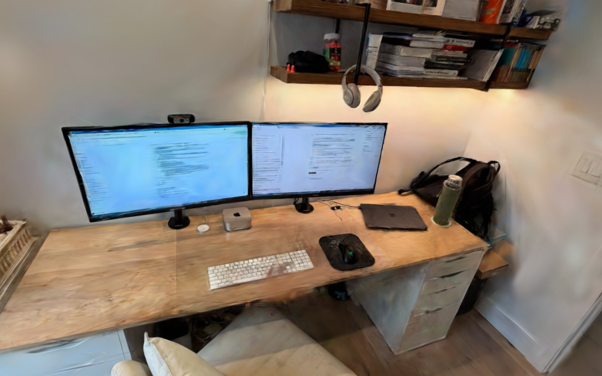
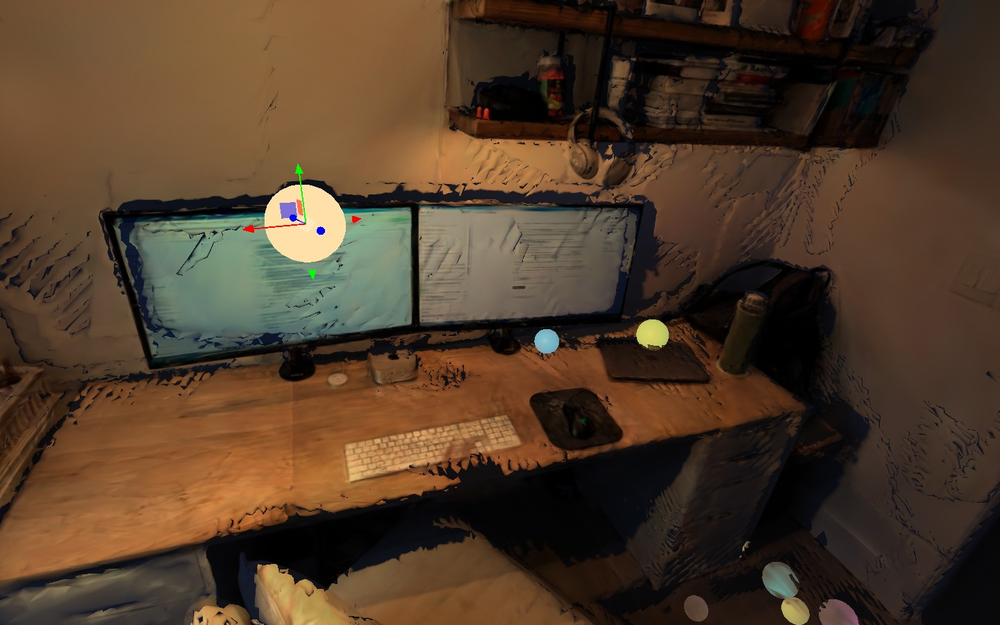
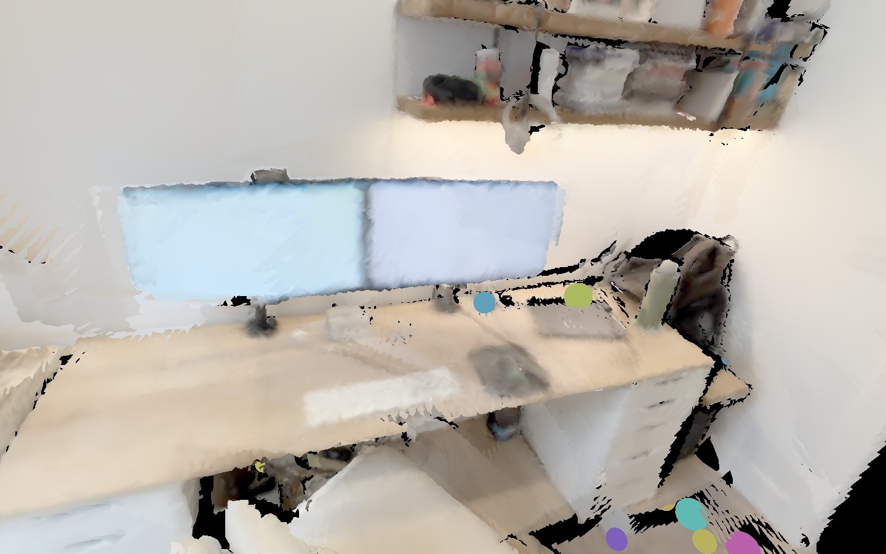
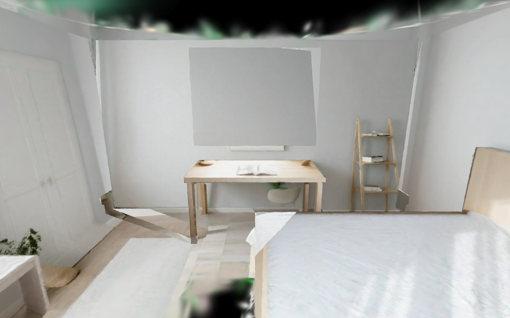
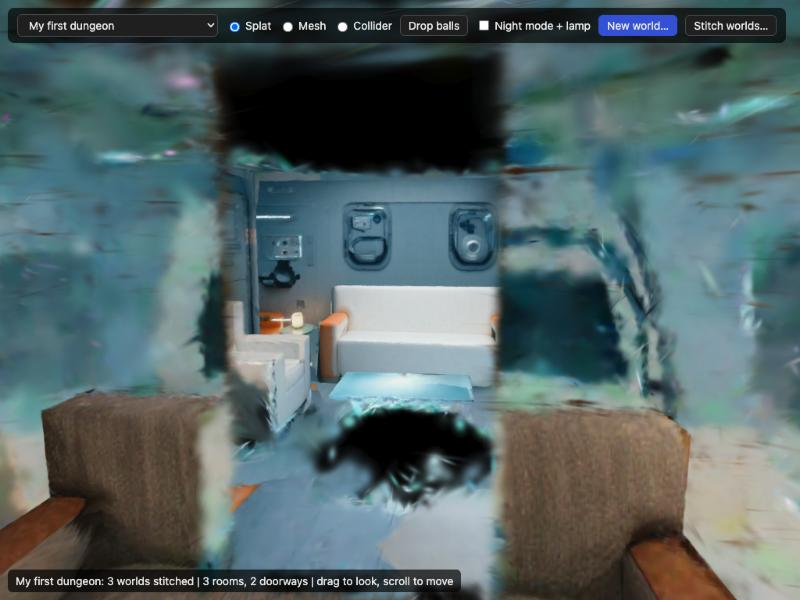

# Prometheus Worlds

The marketing site is in [`../prometheus-worlds-site/`](../prometheus-worlds-site/).

Turn photos of a room, or a sentence describing a room or an outdoor place, into a 3D world you can look around, drop balls in and relight. Worlds built from a sentence can have things that move (trees in wind, a swing, a passing car, insects, falling leaves) and synthesised ambient music and sound. Everything runs on this Mac with local models: no cloud services are called once the models are downloaded.



| | |
|---|---|
|  |  |
| A wizard study built from a prompt in 14.5 minutes | A cabin invented from one sentence |
|  |  |
| Night mode with a draggable lamp | The mesh, with balls resting on the desk |
|  |  |
| A bedroom built from a prompt in the app | The New world dialog |
|  |  |
| Stitching three rooms into one world | Looking through a doorway into the next room |

## What it does

| Tool | Input | Output |
|---|---|---|
| Photos to world | 20 to 60 overlapping photos of a room (JPG, PNG, HEIC) | A Gaussian splat you can orbit |
| Splat to mesh | Any world | A GLB mesh and a collider; balls bounce on it |
| Relight | Any world | Night mode with a draggable lamp and shadows |
| Prompt to world | A layout sentence and a style sentence | A blocked-out room or outdoor place, painted and turned into a splat |
| Moving things and sound | The same layout sentence | Things that sway, swing, spin, bob or travel; swarms of small things; music and sound made in the browser |
| Stitch worlds | Two or more worlds | One bigger world, with doorways between rooms |

In the app, choose **New world…**, then **From your photos** or **From a prompt**. One world is built at a time, and a panel in the corner shows progress.

## Stitching worlds together

Choose **Stitch worlds…** to see your worlds from above with their ceilings hidden.

1. Tick the worlds to include.
2. Click a world to select it, then drag the arrows to move it. Switch to **Rotate** to turn it. **Snap** moves in 25 cm steps and turns in 15° steps.
3. Drop a room near another and it slides so the two walls meet. A green block shows where a doorway will be cut.
4. Name it and choose **Save as one world**.

The stitched world keeps a list of its rooms and where each one sits, so it loads the original worlds side by side. Doorways (1 m wide, 2.1 m tall) are cut through the splats, the mesh and the collider wherever two invented rooms have facing walls that touch, so balls roll from room to room. Chain rooms this way to lay out a dungeon.

## Moving things, outdoor places and sound

This part is new. One outdoor park (two swaying trees, a swing, bees, falling leaves and a passing car) was built end to end in 26 minutes and checked moving in the viewer; other kinds of scene have only had their layouts checked. Nobody has listened to the sound yet.

Say what moves in the layout sentence, for example "a small park on a breezy day: two big trees at the back, a swing in the middle, bees around a flower bed, and a road along the front where a car drives past". The layout model decides which pieces move and how, from a fixed set of motions:

| Motion | What it is | How it is shown |
|---|---|---|
| sway | Held at its base (a tree) or along an edge (a flag, a curtain) and bending in the wind | The object's splats bend in place |
| swing | Hangs from a pivot and rocks like a pendulum | The object is lifted out of the splat and moved as its own splat |
| spin | Turns about its own centre | Lifted out, as above |
| bob | Rises and falls gently | Lifted out, as above |
| path | Travels along 2 to 4 points on the ground | Lifted out, as above |

Small or thin moving things (insects, birds, falling leaves, petals, snow) are not objects. They are effects drawn by the viewer as small coloured blobs: `wander` (flying about one spot) and `drift` (falling or floating down on the wind). A drift with a negative `fall` rises (sparks, bubbles, smoke). An effect marked `"glow": true` gives off light: it gets a soft halo in a world whose mood is dusk or night, and points of light in Night mode. With no `glow` field, small bright-coloured blobs glow only in a dusk or night world. `opacity` (0.05 to 1) is optional.

**How fast things travel.** A travelling object goes at 0.2 to 4 m/s and never crosses its route in under 5 seconds; it waits 4 s between passes unless the plan says otherwise. A straight route that runs along a road but partly off it is moved onto the road.

**Three tries at the layout.** The layout model writes a clearly worse plan about one time in three. Code reads each plan against the sentence, with no model: a counted thing made as fewer pieces, a named thing left out, a swarm made into an object, a motion that had to be dropped, two pieces standing inside each other. A plan with such faults is asked for again, up to three times in all, with the faults listed; the plan with the fewest is kept. Each extra ask costs about 27 s. `boxes.json` from this version carries `"rules": 2` and, when the plan has them, `"grounds"` (roads, ponds, rugs: named to the painter in each view's prompt and pressed faintly into its depth map; `WORLD_RELIEF=0` switches the pressing off).

**Tour.** Tick Tour in the viewer, or open `?scene=Name&tour=1`, for a slow glide round the room (one lap in 50 s or more) that keeps off the strips where things travel. Any key, click or wheel stops it.

Limits set in code: at most 40 moving objects per world, of which at most 12 may be lifted out, and at most 4 effects. A motion the model wrote badly is dropped and the object stays, standing still. Code also adjusts or drops motions that cannot work where the object is: a spinning or bobbing object is raised until it clears the ground; indoors a spinning or swinging object is pulled in from the walls by its reach; a travelling object's points are kept inside the room, by its half-diagonal if the path bends; and only an object taller than it is thick may sway, so a table does not. A travelling object that would run into another object between its points is moved: onto the road it starts on, when the plan has one (a long "ground" piece), else up to 3 m sideways to a clear strip; if neither works it stands still. Two objects travelling the same line get a strip each, side by side. Lights and thin fabric (a lantern, a flag) are normally left to the painter; one that has a motion is kept as an object, and left out again if that motion is dropped. A world with no motion is built exactly as before.

**Outdoor places.** The model marks a layout as outdoor, or you choose Indoors or Outdoors in the prompt pane. The "room" is then the patch of ground you can walk on (3 to 24 m across; the model is asked for 10 to 16 m). Around it is a shell 20 m further out on every side: its floor is the ground, its sides are a painted backdrop and its top is sky. A new static shape, the arch (two posts and a beam), lets a swing hang from a frame. A moving piece can be placed "on" the piece that holds it: under an arch, or on the front of anything else (sails on a tower, a flag on a pole), and never higher than it. A swing's rope length sets how low the seat hangs. A "ground" piece (a road, a path, a pond, a rug) is never built; a long one only marks where things may travel. Outdoors, a piece placed on an edge that a deeper piece already takes (a lamp post where the shop fronts are) stands in front of that piece instead of inside it.

**Sound.** Tick Sound in the viewer to start it. Music (soft pads and bells) is chosen from a mood the layout model writes: one of calm, warm, bright, dreamy, playful, mysterious, melancholy or eerie, with an energy and a time of day. Wind, rustling, buzzing, a rumble and a creak are attached to the things that make them. Everything is synthesised in the browser: there are no audio files and no extra model.

## Requirements

- An Apple Silicon Mac. Developed on an M4 Pro with 64 GB; the pipelines are kept under about 32 GB by running one model at a time.
- macOS 14 or later, Xcode command line tools (`xcode-select --install`), and [Homebrew](https://brew.sh).
- Tens of GB of free disk for model weights, which download on first use.

## Build

From the `local-worlds` folder:

```bash
brew install uv colmap ollama libusb node
```

```bash
ollama pull qwen3.5:9b
```

```bash
uv venv --python 3.12 thread/.venv && uv pip install --python thread/.venv/bin/python -r thread/requirements.txt
```

```bash
uv venv --python 3.12 spike/.venv && uv pip install --python spike/.venv/bin/python -r spike/requirements.txt
```

```bash
npm install --prefix thread/viewer
```

Optional, for real object shapes in invented rooms (without it objects are painted boxes):

```bash
git clone https://github.com/ZimengXiong/Hunyuan3D-Swift ext/Hunyuan3D-Swift && (cd ext/Hunyuan3D-Swift && swift build -c release && hf download zimengxiong/hunyuan3d-mlx-shape-small --local-dir weights/shape-small)
```

`swift build` does not produce MLX's Metal shader library unless full Xcode is installed. Without Xcode, take it from the matching Python package (the version must match the `mlx-swift` the port pins, 0.31.1 here):

```bash
uv pip install --target /tmp/mlx0311 mlx==0.31.1 && cp /tmp/mlx0311/mlx/lib/mlx.metallib ext/Hunyuan3D-Swift/.build/release/
```

```bash
app/build.sh
```

That produces `app/Prometheus Worlds.app`. Drag it to the Desktop or Applications and open it.

The app is a thin window around this folder: it starts `thread/server.py` and shows the page. It stores the folder's path when built, so rebuild it if the folder moves. It is signed ad hoc, for this Mac only.

To run without the app:

```bash
thread/.venv/bin/python thread/server.py 8765
```

Then open `http://127.0.0.1:8765/viewer/index.html`.

To redraw the icon, run `thread/.venv/bin/python make_icon.py` inside `app/`, then rebuild.

## How it works

**Photos to world** (`pipeline.py photos`, a few minutes)

1. COLMAP solves where each photo was taken.
2. msplat trains a Gaussian splat on the Mac's GPU.
3. Depth Pro estimates depth for each photo. Each depth map is scaled to match COLMAP's 3D points, and all of them are fused into one mesh, coloured from the photos.

**Prompt to world** (`pipeline.py prompt`, roughly 14 to 40 minutes depending on detail)

1. Qwen3.5 9B reads the layout sentence and writes a rough plan: indoor or outdoor, the room's size, plus pieces placed against walls, at points, at the corners, or in rings and arcs. A piece is a box, an upright cylinder, an arch, or a named piece of furniture. The plan may also give a piece a motion, list effects, and set wind and mood. Code checks the plan (everything is kept inside the room and resting on the floor, rows are thinned so copies do not overlap, an audience is turned to face a stage) and expands it into the blockout. For motion, code also clamps every number, lets only a piece with a motion sit above the ground, stands a travelling piece at its first point facing the way it goes, shrinks a swing's angle until its arc clears the ground, and gives each copy in a ring its own phase. `WORLD_SETTING=indoor` or `outdoor` overrules the model's choice. `thread/tests/test_layout.py` checks all of this with canned plans, without the model.
2. Objects get real 3D shapes (`shapes.py`), so a car is a car and not a painted box. Qwen groups the objects into kinds that can share a shape, says which deserve one (a car or a sofa does; a platform or a plain pillar does not) and describes each. Z-Image Turbo paints one picture of each kind alone on a plain blue backdrop, the backdrop is cut away, and Hunyuan3D turns the cut-out into a mesh. Each mesh is turned to face the way its block faces, scaled to fit the block without stretching, and stood on the floor or on whatever is under it. Up to six kinds are shaped (set `WORLD_SHAPES`; 0 turns this off). Each kind adds about a minute. If the shape model is not installed, or a shape fails, the object stays a box and the build carries on.
3. The blockout, with the shapes in place of their boxes, is rendered as depth maps from a ring of cameras, plus four to six cameras higher up looking down, so the middle of the floor and the tops of furniture get painted too.
4. Z-Image Turbo with a depth ControlNet paints each view so it follows the blockout. Views are painted in order, and each one is given the pixels that earlier views already show of it, through the ControlNet's inpainting input, so the room stays the same room from every angle (neighbouring views disagree about a third as much as when painted separately). Each view's prompt names only the pieces visible in it. Quick and Standard detail paint at 768x576, Full at 1024x768. A cancelled build resumes from the views already painted.
5. Separately painted views disagree with each other, so each wall, the floor and each furniture piece takes its look from one view only. That view is projected onto the blockout and re-rendered from about 115 cameras: the painted positions, rings near the centre, views pitched up at the ceiling, views looking down at the floor, a grid of standing positions around the room and a low ring. This matters more than anything else for how the splat holds up while you move: a splat is only well-behaved where training cameras have looked, and with cameras only near the centre the floor and off-centre viewpoints turned to streaks and haze. Unpainted patches of a wall or floor continue the surrounding paint. On a generated shape, each point takes its paint from a view that sees it reasonably head-on, and the band of pixels around a shape's outline is not trusted for the wall behind it, because the painted object rarely stays exactly inside its outline.
6. msplat trains a splat from those views. The blockout (boxes, cylinders and the generated shapes) serves as the mesh and collider.
7. Only for worlds with a swinging, spinning, bobbing or travelling object: step 5 writes a second set of views without those objects, where the ground and wall behind them are filled from the surrounding paint. Both sets are trained. `movers.py` copies each such object's splats out of the splat that has them, and the viewer shows the splat without them plus each mover as its own small splat.

Outdoors, the depth maps given to the painter show the backdrop and sky as pure black (endlessly far), each view's prompt starts "outdoor photo" and names what lies beyond only when enough backdrop is in view, and the sky above the painted band is one colour taken from the painted sky.

**Viewer** (`thread/viewer`): three.js with Spark for splats and Rapier for physics. Night mode multiplies the splat by the light reaching the mesh, so splat detail survives.

## Models

| Model | Job | Runs through |
|---|---|---|
| Qwen3.5 9B | Layout sentence to furniture placement | Ollama |
| Z-Image Turbo + Z-Image-Turbo-Fun-Controlnet-Union 2.1 (the `2601-8steps` distilled file, 6.7 GB) | Painting views that follow the blockout | mflux (MLX) |
| Depth Pro | Depth for each photo | mflux (MLX) |
| Hunyuan3D 2.0 shape (mini, 3.8 GB) | A picture of one object to a 3D mesh, about 20 s and 5.5 GB | [Hunyuan3D-Swift](https://github.com/ZimengXiong/Hunyuan3D-Swift) (MLX) |

COLMAP, msplat, Open3D, three.js, Spark and Rapier do the rest and have no model weights. Check each model's licence before using this for anything beyond personal use. The Hunyuan3D licence does not cover use in the EU, the UK or South Korea.

## Speed notes

Painting views dominates a prompt build. Measured on an M4 Pro: about 57 s per view at 768x576 with 8 steps (about 49 s with the Quick level's 6 steps), down from about 160 s at 1024x768. The gains come from patches applied to mflux in memory (`speed_patches` in `thread/chisel_ring.py`): the control input is kept in the model's 16-bit format so the transformer does not fall back to 32-bit, each distinct prompt is encoded once, and the blockout depth map is used directly. Peak memory while painting is about 18 GB.

Tried and not adopted: a full-resolution training schedule (2.4 times slower with no gain on a held-out score), the unquantised image model (no faster, 33 GB), and Rapier's internal-edge fix for colliders (it made walls one-sided, so balls rolled out through them).

## What was tried for splat quality and dropped

- Seeding training from depth-lifted pixels of the painted views: objects gained real shape but the result was ragged, and the trainer drops splats when too many fall in one screen tile.
- Building the splat directly with no training (flat splats on exact planes plus depth-lifted relief): no streaks, but blurrier walls and holes where no view looked.

## Known limits

- **Large halls are still weak.** In a 12 m garage the floor and ceiling are soft patchwork and objects far from the middle are blurry up close: the pictures are too coarse for that much room.
- **Generated shapes are only as good as one picture.** Copies of a kind are identical, the side the picture did not show is guessed, and paint on a shape shows seams where two views meet.
- **Photo worlds need many more photos than 20 to hold up while moving.** There is no way to invent extra views of a real room; expect good results only near where photos were taken.

- **Objects without a generated shape are painted onto simple shapes**, so they look right from the front and flatter from the side. Some seams remain where surfaces meet.
- **Invented spaces are box-shaped rooms** (or, outdoors, flat rectangular patches of ground) from 3 to 24 m across, filled with boxes, cylinders, a fixed set of furniture blocks and generated shapes. Curved walls, sloped roofs, stairs and tiers are not possible; a tent or dome exists only as painted texture.
- **The layout model is small and makes spatial mistakes.** Code catches the common ones, but an unusual description can still give an odd arrangement.
- **Photo meshes have holes** where no photo looked, and their colour is per vertex, so it is blurry. Balls can fall through holes; a flat safety floor catches them.
- **Invented rooms have a plain ceiling.** It is a flat light colour, not painted.
- **Outdoors is a flat painted surround** about 20 m away, with plain sky above roughly 20°. There are no hills or clouds overhead, and far ground is soft. Outdoor worlds cannot be stitched to rooms yet.
- **Trees are solid painted shapes.** Clumps of the crown bend in the wind, but sky never shows through leaves and single leaves do not flutter. The falling-leaf effect supplies that impression.
- **The swing is the weakest part.** The seat is a small painted plank with ropes drawn by the viewer, and the frame is plain posts. The painter may draw its own chains, which then stay on the background.
- **A travelling object slides rigidly.** A car's wheels do not turn. It lies along its path but may travel tail-first. It follows the road only if the layout model left one clear. The ground where it was painted is a soft filled patch, and a painted contact shadow may stay there. The side of it that faced away from every painted view is one flat colour.
- **Moving objects are only partly kept apart.** Code keeps them clear of the ground and, indoors, of the walls and ceiling, and keeps a travelling object off other objects between its points. But a spinning or swinging object can pass through a neighbour, two paths may cross, and outdoors a travelling object leaves past its last point through whatever stands there (a hedge on the edge). Outdoors a spinning or travelling object may reach past the edge of the walkable ground.
- **The layout model is unsteady.** Tried on five sentences over four rounds of prompt changes: the same park sentence gave the car a route along the road in two rounds and straight across the park in two (code now moves it onto the road); a street lost its cars in two rounds; a windmill's sails came out as a small block. Pieces can still overlap, a "flower bed" may be a 2 m slab, and butterflies were given a bird's chirp.
- **Outdoor painting, seen on single views only:** open sky, grass running to a far tree or fence line, no wall or ledge at the horizon, and the swing painted on its frame and seat. But the painter adds trees of its own against the sky, each view invents a different distance (a fence in one, blossom trees and a lake in another), and a tree left as a plain wide cylinder is painted as a clipped conifer or a round timber wall.
- **Bees and leaves are small coloured blobs,** not modelled creatures. They pass through objects and are unlit at night.
- **Night mode lights swaying foliage at its rest position.**
- **The layout model decides what moves.** It can tag the wrong piece (code refuses a sway only on low, wide things; a tall cabinet tagged as swaying would bend) or misjudge indoor versus outdoor; the Indoors/Outdoors choice overrides the latter.
- **Build time** grows by about 2 minutes for a world with a swinging or travelling thing (measured on the park: a second re-projection pass and a second training).
- **Music is synthesised in the browser.** So far it has been measured, not heard, and it has not been run in the app's own window. Levels may differ by a few dB there, and the reverb may need shortening.
- **What the park build showed.** The car, swing and trees move and nothing is left behind them, but the look is rough: tree crowns have flat olive patches and ragged leaves up close, the car is mottled on the sides no painted view saw and does not follow the painted road, and the ground where it was painted is a striped patch. The layout model merges or misplaces pieces in about a third of tries.
- **Not yet verified:** night mode with moving things, motion inside stitched worlds, outdoor scenes other than the park, a build started from the app's own dialog, and the sound by ear or in the app's own window.
- **Not yet tested with Wi-Fi off.** Nothing calls out after the models are downloaded, but that has not been verified.
- **Doorways are cut only between invented rooms.** Worlds made from photos can be placed in a stitched world but get no doorway, because their walls are not known exactly.
- **A doorway cuts through whatever is there**, including furniture standing against that wall.
- **There is no walking mode yet.** You look around with an orbit camera; moving through a dungeon on foot is not built.
- No export of relit splats, no texture baking, no flythrough video from the app.

## Layout

| Path | What |
|---|---|
| `app/` | The macOS app: `main.swift`, `build.sh`, `make_icon.py` |
| `thread/server.py` | Local server: static files plus the job API |
| `thread/pipeline.py` | The two pipelines |
| `thread/shapes.py` | Real 3D shapes for the objects of an invented room |
| `thread/llm_boxes.py` | The layout model's plan, checked and expanded: pieces, motions, effects, indoor or outdoor |
| `thread/movers.py` | Lifts moving objects out of the trained splat |
| `thread/viewer/motion.js`, `audio.js` | Motion and effects in the viewer; synthesised music and sound |
| `thread/tests/test_layout.py` | Checks of the layout code with canned plans (`cd thread && .venv/bin/python -m unittest tests.test_layout`) |
| `experiments/living-scenes/` | The studies and plan behind moving things, outdoor places and sound |
| `ext/` | Third-party code and weights fetched at build time (not in git) |
| `experiments/object-shapes/` | The test that showed generated shapes work |
| `thread/viewer/` | The page |
| `thread/worlds/` | Worlds built in the app (not in git) |
| `thread/scenes.json` | The list of worlds, including stitched ones (not in git) |
| `spike/` | The image-model environment and `blockout.py`, the box renderer |
| `STEEL-THREAD-PLAN.md` | The plan for the spike that first connected everything |
