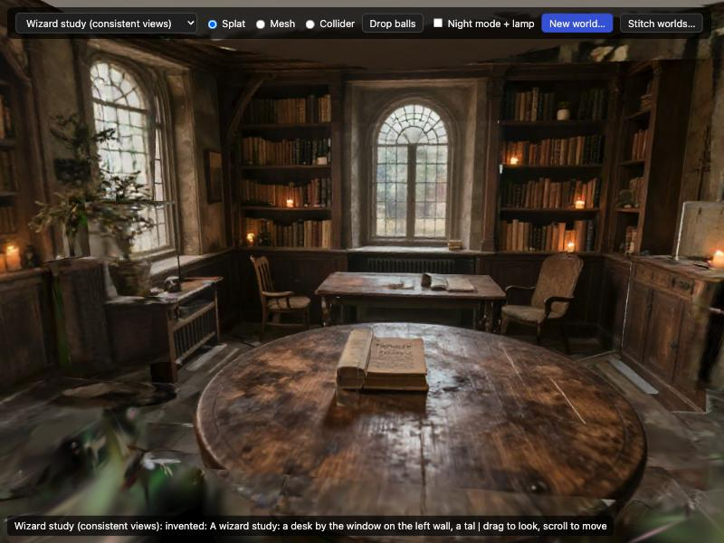
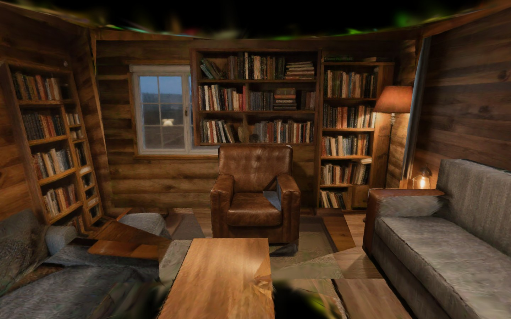
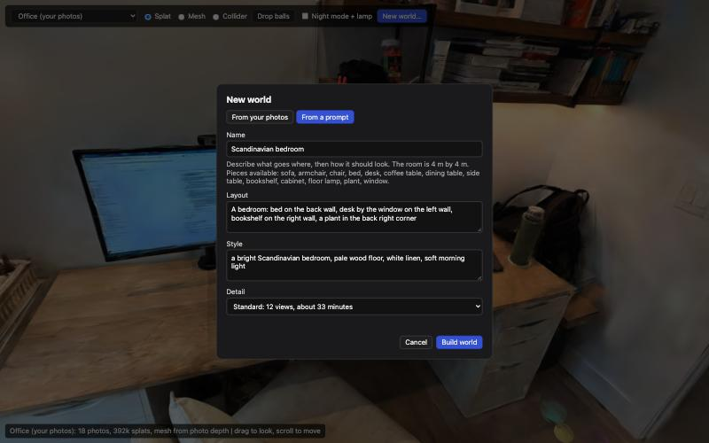
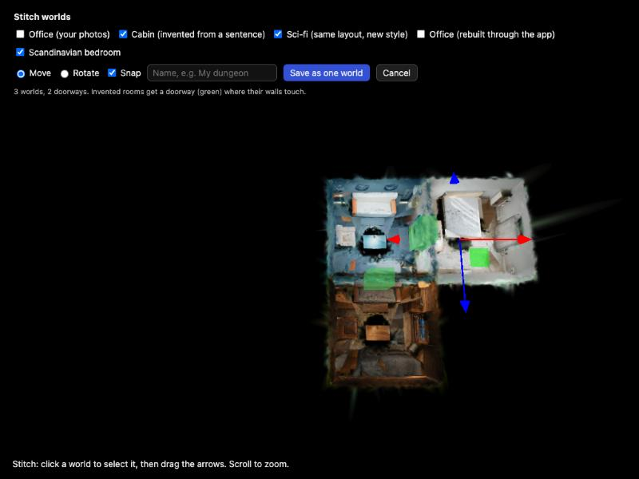

# Nate's Worlds

The public name for this app is **Prometheus Worlds**. The Mac app and this folder still use the current title. The marketing site is in [`../prometheus-worlds-site/`](../prometheus-worlds-site/).

Turn photos of a room, or a sentence describing one, into a 3D world you can look around, drop balls in and relight. Everything runs on this Mac with local models: no cloud services are called once the models are downloaded.


| | |
|---|---|
|  |  |
| A wizard study built from a prompt in 14.5 minutes | A cabin invented from one sentence |
|  |  |
| Night mode with a draggable lamp | The mesh, with balls resting on the desk |
|  |  |
| A bedroom built from a prompt in the app | The New world dialog |
|  |  |
| Stitching three rooms into one world | Looking through a doorway into the next room |

## What it does

| Tool | Input | Output |
|---|---|---|
| Photos to world | 20 to 60 overlapping photos of a room (JPG, PNG, HEIC) | A Gaussian splat you can orbit |
| Splat to mesh | Any world | A GLB mesh and a collider; balls bounce on it |
| Relight | Any world | Night mode with a draggable lamp and shadows |
| Prompt to world | A layout sentence and a style sentence | A blocked-out room, painted and turned into a splat |
| Stitch worlds | Two or more worlds | One bigger world, with doorways between rooms |

In the app, choose **New world…**, then **From your photos** or **From a prompt**. One world is built at a time, and a panel in the corner shows progress.

## Stitching worlds together

Choose **Stitch worlds…** to see your worlds from above with their ceilings hidden.

1. Tick the worlds to include.
2. Click a world to select it, then drag the arrows to move it. Switch to **Rotate** to turn it. **Snap** moves in 25 cm steps and turns in 15° steps.
3. Drop a room near another and it slides so the two walls meet. A green block shows where a doorway will be cut.
4. Name it and choose **Save as one world**.

The stitched world keeps a list of its rooms and where each one sits, so it loads the original worlds side by side. Doorways (1 m wide, 2.1 m tall) are cut through the splats, the mesh and the collider wherever two invented rooms have facing walls that touch, so balls roll from room to room. Chain rooms this way to lay out a dungeon.

## Requirements

- An Apple Silicon Mac. Developed on an M4 Pro with 64 GB; the pipelines are kept under about 32 GB by running one model at a time.
- macOS 14 or later, Xcode command line tools (`xcode-select --install`), and [Homebrew](https://brew.sh).
- Tens of GB of free disk for model weights, which download on first use.

## Build

From the `local-worlds` folder:

```bash
brew install uv colmap ollama libusb node
```

```bash
ollama pull qwen3.5:9b
```

```bash
uv venv --python 3.12 thread/.venv && uv pip install --python thread/.venv/bin/python -r thread/requirements.txt
```

```bash
uv venv --python 3.12 spike/.venv && uv pip install --python spike/.venv/bin/python -r spike/requirements.txt
```

```bash
npm install --prefix thread/viewer
```

Optional, for real object shapes in invented rooms (without it objects are painted boxes):

```bash
git clone https://github.com/ZimengXiong/Hunyuan3D-Swift ext/Hunyuan3D-Swift && (cd ext/Hunyuan3D-Swift && swift build -c release && hf download zimengxiong/hunyuan3d-mlx-shape-small --local-dir weights/shape-small)
```

`swift build` does not produce MLX's Metal shader library unless full Xcode is installed. Without Xcode, take it from the matching Python package (the version must match the `mlx-swift` the port pins, 0.31.1 here):

```bash
uv pip install --target /tmp/mlx0311 mlx==0.31.1 && cp /tmp/mlx0311/mlx/lib/mlx.metallib ext/Hunyuan3D-Swift/.build/release/
```

```bash
app/build.sh
```

That produces `app/Nate's Worlds.app`. Drag it to the Desktop or Applications and open it.

The app is a thin window around this folder: it starts `thread/server.py` and shows the page. It stores the folder's path when built, so rebuild it if the folder moves. It is signed ad hoc, for this Mac only.

To run without the app:

```bash
thread/.venv/bin/python thread/server.py 8765
```

Then open `http://127.0.0.1:8765/viewer/index.html`.

To redraw the icon, run `thread/.venv/bin/python make_icon.py` inside `app/`, then rebuild.

## How it works

**Photos to world** (`pipeline.py photos`, a few minutes)

1. COLMAP solves where each photo was taken.
2. msplat trains a Gaussian splat on the Mac's GPU.
3. Depth Pro estimates depth for each photo. Each depth map is scaled to match COLMAP's 3D points, and all of them are fused into one mesh, coloured from the photos.

**Prompt to world** (`pipeline.py prompt`, roughly 14 to 40 minutes depending on detail)

1. Qwen3.5 9B reads the layout sentence and writes a rough plan: the room's size, plus pieces placed against walls, at points, at the corners, or in rings and arcs. A piece is a box, an upright cylinder, or a named piece of furniture. Code checks the plan (everything is kept inside the room and resting on the floor, rows are thinned so copies do not overlap, an audience is turned to face a stage) and expands it into the blockout.
2. Objects get real 3D shapes (`shapes.py`), so a car is a car and not a painted box. Qwen groups the objects into kinds that can share a shape, says which deserve one (a car or a sofa does; a platform or a plain pillar does not) and describes each. Z-Image Turbo paints one picture of each kind alone on a plain blue backdrop, the backdrop is cut away, and Hunyuan3D turns the cut-out into a mesh. Each mesh is turned to face the way its block faces, scaled to fit the block without stretching, and stood on the floor or on whatever is under it. Up to six kinds are shaped (set `WORLD_SHAPES`; 0 turns this off). Each kind adds about a minute. If the shape model is not installed, or a shape fails, the object stays a box and the build carries on.
3. The blockout, with the shapes in place of their boxes, is rendered as depth maps from a ring of cameras, plus four to six cameras higher up looking down, so the middle of the floor and the tops of furniture get painted too.
4. Z-Image Turbo with a depth ControlNet paints each view so it follows the blockout. Views are painted in order, and each one is given the pixels that earlier views already show of it, through the ControlNet's inpainting input, so the room stays the same room from every angle (neighbouring views disagree about a third as much as when painted separately). Each view's prompt names only the pieces visible in it. Quick and Standard detail paint at 768x576, Full at 1024x768. A cancelled build resumes from the views already painted.
5. Separately painted views disagree with each other, so each wall, the floor and each furniture piece takes its look from one view only. That view is projected onto the blockout and re-rendered from about 115 cameras: the painted positions, rings near the centre, views pitched up at the ceiling, views looking down at the floor, a grid of standing positions around the room and a low ring. This matters more than anything else for how the splat holds up while you move: a splat is only well-behaved where training cameras have looked, and with cameras only near the centre the floor and off-centre viewpoints turned to streaks and haze. Unpainted patches of a wall or floor continue the surrounding paint. On a generated shape, each point takes its paint from a view that sees it reasonably head-on, and the band of pixels around a shape's outline is not trusted for the wall behind it, because the painted object rarely stays exactly inside its outline.
6. msplat trains a splat from those views. The blockout (boxes, cylinders and the generated shapes) serves as the mesh and collider.

**Viewer** (`thread/viewer`): three.js with Spark for splats and Rapier for physics. Night mode multiplies the splat by the light reaching the mesh, so splat detail survives.

## Models

| Model | Job | Runs through |
|---|---|---|
| Qwen3.5 9B | Layout sentence to furniture placement | Ollama |
| Z-Image Turbo + Z-Image-Turbo-Fun-Controlnet-Union 2.1 (the `2601-8steps` distilled file, 6.7 GB) | Painting views that follow the blockout | mflux (MLX) |
| Depth Pro | Depth for each photo | mflux (MLX) |
| Hunyuan3D 2.0 shape (mini, 3.8 GB) | A picture of one object to a 3D mesh, about 20 s and 5.5 GB | [Hunyuan3D-Swift](https://github.com/ZimengXiong/Hunyuan3D-Swift) (MLX) |

COLMAP, msplat, Open3D, three.js, Spark and Rapier do the rest and have no model weights. Check each model's licence before using this for anything beyond personal use. The Hunyuan3D licence does not cover use in the EU, the UK or South Korea.

## Speed notes

Painting views dominates a prompt build. Measured on an M4 Pro: about 57 s per view at 768x576 with 8 steps (about 49 s with the Quick level's 6 steps), down from about 160 s at 1024x768. The gains come from patches applied to mflux in memory (`speed_patches` in `thread/chisel_ring.py`): the control input is kept in the model's 16-bit format so the transformer does not fall back to 32-bit, each distinct prompt is encoded once, and the blockout depth map is used directly. Peak memory while painting is about 18 GB.

Tried and not adopted: a full-resolution training schedule (2.4 times slower with no gain on a held-out score), the unquantised image model (no faster, 33 GB), and Rapier's internal-edge fix for colliders (it made walls one-sided, so balls rolled out through them).

## What was tried for splat quality and dropped

- Seeding training from depth-lifted pixels of the painted views: objects gained real shape but the result was ragged, and the trainer drops splats when too many fall in one screen tile.
- Building the splat directly with no training (flat splats on exact planes plus depth-lifted relief): no streaks, but blurrier walls and holes where no view looked.

## Known limits

- **Large halls are still weak.** In a 12 m garage the floor and ceiling are soft patchwork and objects far from the middle are blurry up close: the pictures are too coarse for that much room.
- **Generated shapes are only as good as one picture.** Copies of a kind are identical, the side the picture did not show is guessed, and paint on a shape shows seams where two views meet.
- **Photo worlds need many more photos than 20 to hold up while moving.** There is no way to invent extra views of a real room; expect good results only near where photos were taken.

- **Objects without a generated shape are painted onto simple shapes**, so they look right from the front and flatter from the side. Some seams remain where surfaces meet.
- **Invented spaces are box-shaped rooms** from 3 to 24 m across, filled with boxes, cylinders, a fixed set of furniture blocks and generated shapes. Curved walls, sloped roofs, stairs and tiers are not possible; a tent or dome exists only as painted texture.
- **The layout model is small and makes spatial mistakes.** Code catches the common ones, but an unusual description can still give an odd arrangement.
- **Photo meshes have holes** where no photo looked, and their colour is per vertex, so it is blurry. Balls can fall through holes; a flat safety floor catches them.
- **Invented rooms have a plain ceiling.** It is a flat light colour, not painted.
- **Not yet tested with Wi-Fi off.** Nothing calls out after the models are downloaded, but that has not been verified.
- **Doorways are cut only between invented rooms.** Worlds made from photos can be placed in a stitched world but get no doorway, because their walls are not known exactly.
- **A doorway cuts through whatever is there**, including furniture standing against that wall.
- **There is no walking mode yet.** You look around with an orbit camera; moving through a dungeon on foot is not built.
- No export of relit splats, no texture baking, no flythrough video from the app.

## Layout

| Path | What |
|---|---|
| `app/` | The macOS app: `main.swift`, `build.sh`, `make_icon.py` |
| `thread/server.py` | Local server: static files plus the job API |
| `thread/pipeline.py` | The two pipelines |
| `thread/shapes.py` | Real 3D shapes for the objects of an invented room |
| `ext/` | Third-party code and weights fetched at build time (not in git) |
| `experiments/object-shapes/` | The test that showed generated shapes work |
| `thread/viewer/` | The page |
| `thread/worlds/` | Worlds built in the app (not in git) |
| `thread/scenes.json` | The list of worlds, including stitched ones (not in git) |
| `spike/` | The image-model environment and `blockout.py`, the box renderer |
| `STEEL-THREAD-PLAN.md` | The plan for the spike that first connected everything |
