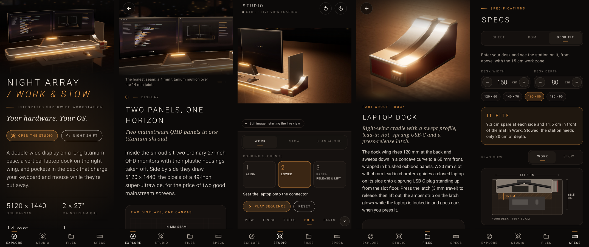
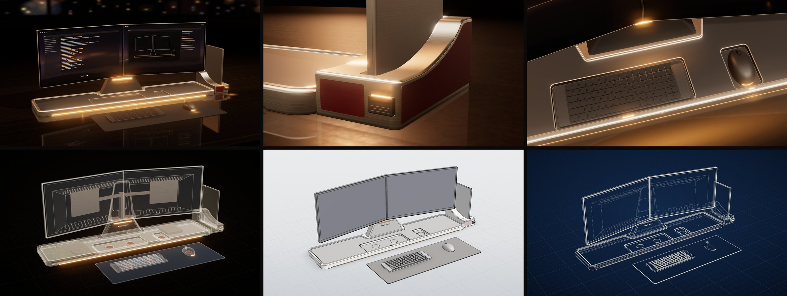

# Night Array: Work & Stow

An Android app for exploring, and getting inspired by, a concept desk battle station. It contains the station's **real CAD files** and a **live CAD renderer**. Two 27" monitors sit side by side in one titanium shroud on a long titanium base. Your laptop docks standing up on the right wing, and the keyboard and mouse charge wirelessly in pockets in the deck.

*Your hardware. Your OS.*





## The station

| | |
|---|---|
| **Display** | Two mainstream 27" QHD IPS monitors (2560 × 1440 each) with their plastic housings removed. They're mounted on a steel VESA spine inside one titanium shroud, each turned 10° toward you, for a 5120 × 1440 canvas about 1.22 m wide. That's the pixel count of a 49" super-ultrawide for the price of two good mainstream screens. A dead panel is a cheap swap, and your OS already knows what to do with two displays. |
| **The honest seam** | The two active areas are 14 mm apart. The seam is part of the deal, so instead of hiding it there's a 4 mm titanium strip down the middle. |
| **Base & charging pockets** | A 1290 × 300 × 36 mm titanium tray with a raised rim and a recessed graphite deck. The keyboard and mouse pockets have soft-touch pads over flat Qi2 coils (two under the keyboard, one under the mouse). Amber marks on the pocket lips breathe while they charge. |
| **Work & Stow** | **Work:** the keyboard and mouse sit on a felt mat, with 15 cm of open desk in front of the base. **Stow & charge:** they lift back over the rim and drop into their pockets, and the desk in front is empty. |
| **Dock** | A right-wing cradle with a swept profile, oxblood side panels, a 20 mm lead-in slot and a sprung USB-C plug. **1 Align, 2 Lower, 3 Press-release & lift.** |
| **Standalone** | Compute stays in the base (mainboard, vapor chamber, slim blower, internal PSU), so the station runs with the laptop out. |
| **Light & finish** | Amber light is used as a signal: neck light bar, base under-glow, charge marks and the dock latch. Finishes: Neutral Titanium, Charcoal Graphite, Brushed Oxblood. |

The first concept board drew a single curved ultrawide. Everything else on it carried over, and the display became the dual-27" design above. The board is in the app, under **Explore → Where it started**.

All numbers are concept-level. The masses come from the CAD volumes and real material densities, and the app labels them as estimates.

## What's in the app

- **Explore**
  - A hero render and the three modes (Work / Stow & Charge / Standalone).
  - Eight feature stories, each with renders, specs and a "See it live" button.
  - The docking sequence, the finishes, the design principles and the original concept board.
  - **Night shift**: a full-screen, slowly orbiting ambient mode.
- **Studio**: the live CAD renderer (three.js inside one WebView, fully offline).
  - **Styles:** Studio (PBR night scene with amber bloom), CAD (grey solids with black B-rep edges), X-ray (the internals: coils, boards, VESA spine) and Blueprint.
  - **Modes and docking:** animated mode changes and the docking sequence.
  - **Finish and light:** finish swatches and an amber-light slider.
  - **Tools:** explode, section plane, dimension callouts, camera presets and auto-rotate.
  - **Parts:** tap any part for its sheet (Isolate / Frame / Files).
  - Until the live view is ready (or on a device without WebGL2), the Studio shows the matching pre-rendered still.
- **Files** is the CAD library: the full assembly plus nine part groups. Each group has a render, a description, its parts, its engineering drawing sheet (pinch to zoom), and **Share** or **Save** for every file: STEP, STL, GLB, SVG drawing and DXF.
- **Specs**:
  - A spec sheet built from the CAD parameters.
  - A bill of materials of all 41 parts with masses.
  - **Desk fit**: enter your desk size to see a plan view of the station on it, including the 15 cm work zone.

## CAD files

Everything is generated from one parametric CadQuery model and kept in [`cad/export/`](cad/export/):

| File | |
|---|---|
| [`files/night-array-assembly.step`](cad/export/files/night-array-assembly.step) | Full assembly, STEP AP214, mm, Z-up (opens upright in CAD tools), named and coloured parts |
| `files/parts/<group>.step`, `.stl` | One STEP and one binary STL (Z-up) per group: display, stand, base, dock, laptop, keyboard, mouse, deskmat, internals |
| `files/drawings/<group>.svg`, `-top.dxf` | A3 drawing sheets (three views + isometric, dimensions, parts list, title block) and top-view outlines |
| [`model/station.glb`](cad/export/model/station.glb) | The assembly as glTF (metres, Y-up, one node per part), used by the app's renderer and viewable anywhere |
| `model/scene.json` | Parts, groups, masses, poses, explode vectors, docking sequence, dimensions and a file index |

See [`cad/README.md`](cad/README.md) for how to open them in FreeCAD, Fusion and Onshape.

## Install

Download [`NightArray.apk`](NightArray.apk) on an Android phone or tablet (Android 8.0+), open it, and allow installs from that source when prompted. It's signed with a debug key, so Play Protect may warn that the developer is unknown. The live Studio needs WebGL2, which current Android System WebView has on almost all devices; without it, the app shows the rendered stills instead.

## Layout

```
night-array/
  NightArray.apk     prebuilt app
  SPEC.md            the contract between the three parts below (coordinates, part ids, JSON shapes, JS bridge)
  cad/               parametric CAD (Python + CadQuery) → cad/export/ (committed deliverables, also packaged into the app)
  viewer/            live renderer (three.js 0.170, esbuild) → android/app/src/main/assets/viewer/ + renders/
  android/           Kotlin + Jetpack Compose app
  docs/              README images
```

## Build

```bash
# 1. CAD → cad/export (about a minute; byte-for-byte reproducible)
cd night-array/cad && python3 -m venv .venv && .venv/bin/pip install -r requirements.txt
.venv/bin/python build.py && .venv/bin/python verify.py

# 2. Renderer → app assets (needs Node 22; Playwright's Chromium for tests and stills)
cd ../viewer && npm ci
npm run build          # bundle into android/app/src/main/assets/viewer/
npm test               # headless WebGL2 smoke test of the whole JS API
npm run test:bridge    # replays the exact JS the Android code sends (run step 3's gradle tests first)
npm run stills         # re-render android/app/src/main/assets/renders/*.jpg (about 6 minutes)

# 3. App
cd ../android
gradle testDebugUnitTest   # Robolectric tests of every screen, plus screenshots in app/build/screenshots/
gradle assembleRelease     # → app/build/outputs/apk/release/app-release.apk
```

Requires JDK 21, Gradle 8.14 and the Android SDK (platform 36, build-tools 36). Put the SDK path in `android/local.properties`. Steps 1 and 2 are optional: their outputs are committed.

## Testing notes

- **CAD:** `verify.py` checks part envelopes and that parts never collide, in every pose, along the keyboard and mouse travel paths, through each docking step and across the explode range. It also re-imports every STEP and validates both GLBs with the Khronos glTF validator.
- **Renderer:** its smoke test runs the full JS API in headless Chromium with software WebGL2. A separate harness replays the exact JavaScript calls the Android code sends.
- **App:** Robolectric tests cover every screen and the bridge's event handling.
- **Not yet tested on a real phone:** no emulator was available, so the live renderer's frame rate and touch handling haven't been checked on actual hardware.
