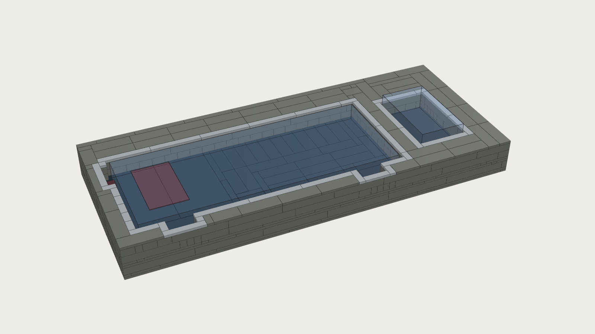
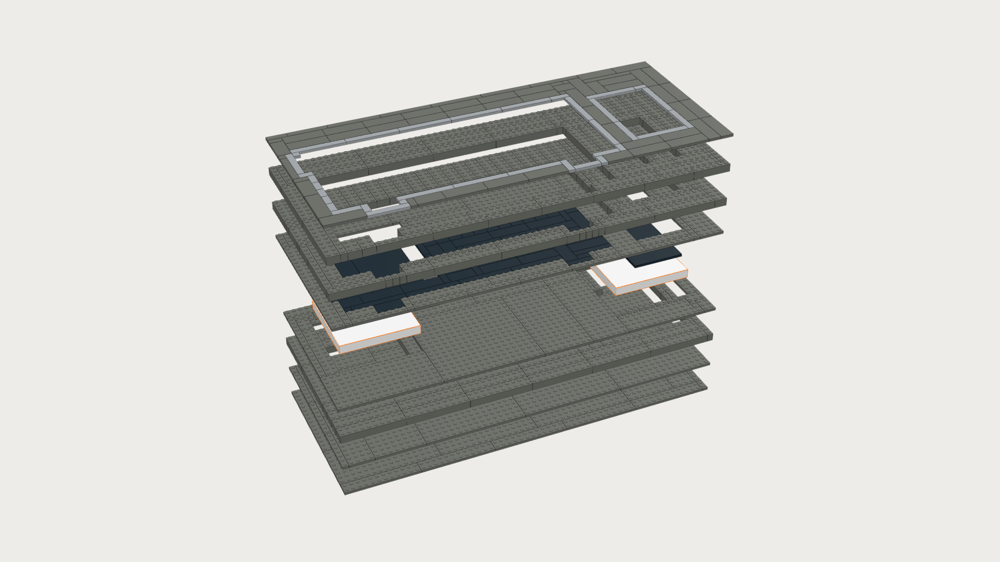
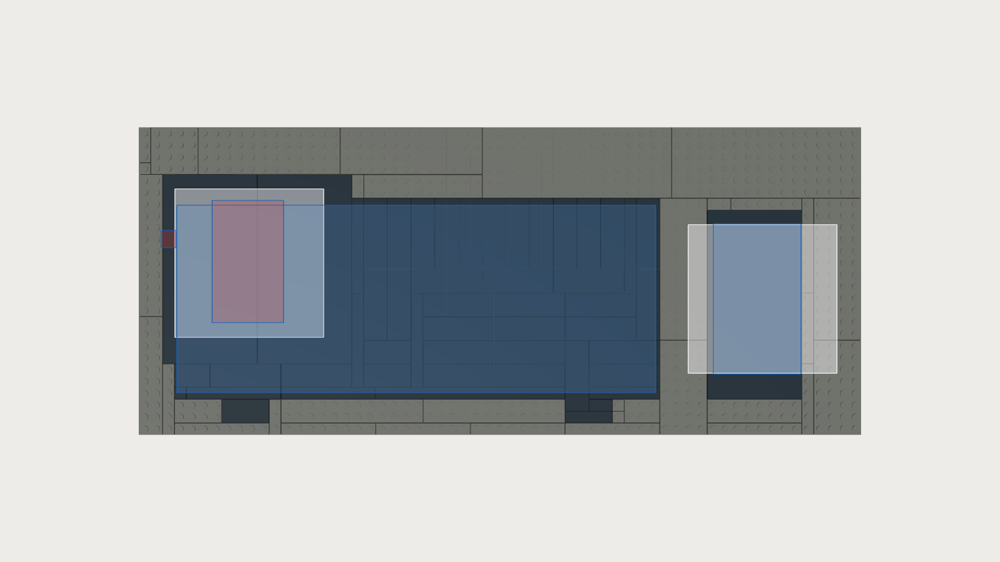

# Night Array pocket section: LEGO version

A LEGO build of the Night Array **pocket section** desk tray (the resin version is in [`../poc`](../poc/README.md)). It has a keyboard pocket for the Keychron K3 Ultra (with its NILLKIN Magic Tag receiver) and a mouse pocket for the Lenovo X9. Each device charges from an Anker 313 Qi pad hidden under its pocket, through **one layer of LEGO tiles (3.2 mm)**. Every part is a common, current LEGO part in Dark Bluish Gray, Black or Light Bluish Gray. No part contains metal.

The full station built round this tray (base, necks, screen frame for two monitors, dock) is in [`station/`](station/README.md).



| | |
|---|---|
| Size | **61 × 26 studs, 14 plates high = 488 × 208 × 44.8 mm** (the resin tray is 487 × 205 × 44) |
| Keyboard pocket | 41 × 17 studs (328 × 136 mm): 3.7 mm clearance left/right, 5.0 mm front/back. A 1 × 5-stud relief in the left wall takes the Magic Tag plug (11.7 mm of room for its ~10 mm), and 2 finger notches in the front wall help you lift the keyboard out |
| Mouse pocket | 8 × 13 studs (64 × 104 mm): 2.5 mm clearance left/right, 1.5 mm front/back |
| Pocket floors | 22.4 mm above the desk; pockets 22.4 mm deep. Keyboard keycaps sit 2.4 mm below the rim at the front and 3.1 mm above it at the back. The mouse stands 11.6 mm proud of the rim |
| Parts | **535 parts** (258 bricks, 129 plates, 148 tiles), 55 part/colour lines |
| Estimated cost | **about $200** on BrickLink (see below) |

Everything is generated by [`make_lego_base.py`](make_lego_base.py) (plain `python3`, no dependencies). All dimensions are parameters at the top of the script:

```
python3 night-array/kit/lego/make_lego_base.py              # model, lists, checks, images
python3 night-array/kit/lego/make_lego_base.py --no-render  # skip the images
```

The images come from `render_lego.mjs` (headless Chromium + three.js from `night-array/viewer/node_modules`).

## Files

| File | What it is |
|---|---|
| `night-array-base.ldr` | LDraw model. 10 build steps (one `STEP` each) with a comment per step. The front of the tray faces LDraw −Z, so the "front" view looks at the side you sit at. The pads, foam and cables are not LEGO, so they are not in the file |
| `parts.csv` | Part list: LDraw/BrickLink id, name, colour (LDraw + BrickLink ids), qty, estimated price |
| `bricklink-wanted.xml` | BrickLink wanted-list upload (`ITEMTYPE P`, BrickLink colour ids 85 / 11 / 86, `MINQTY`) |
| `bricks.json` | Every part as a box in mm for a 3D viewer: `part, name, kind, color, color_hex, x, y, z, sx, sy, sz, step`. Frame: **x to the right, y depth toward you (0 = back edge), z up (0 = underside), origin at the back-left-bottom corner**. Boxes sit on the nominal 8 mm grid (real parts are 0.1 mm smaller per side). Studs are not listed; draw one (Ø 4.8 × 1.7 mm) on every 8 mm cell of each non-tile part. `reference` holds the keyboard, mouse, both pads, the foam squares, the micro-USB plugs and the Magic Tag as plain boxes |
| `checks.json` | The self-check results and summary numbers |
| `steps/step-01.png` … `step-10.png` | Build so far after each step. The new parts have orange outlines; earlier parts are faded |
| `overview.png`, `exploded.png`, `floor-plan.png` | Assembled view, exploded view, and a top view of the floor layer with the pads (white), the keyboard and mouse (blue) and the Magic Tag receiver (red) outlined |

## Opening the model

- **BrickLink Studio:** *File → Import → Import LDraw file*, then choose `night-array-base.ldr`. Studio keeps the steps, and its *Instructions* mode can make a printable booklet.
- **LeoCAD:** *File → Open*. **LDCad:** open the file and use the step slider.

## Buying the parts

1. Upload the wanted list. On BrickLink, go to *Want → Wanted Lists → Upload*, paste the contents of `bricklink-wanted.xml` (or choose the file) and create a new list. Then use *Buy All* or *Easy Buy* to find shops that can fill most of it.
2. Or, in Studio, after importing the model: *File → Export as → Export to BrickLink XML*, or use the price/order panel. That gives you the same list.
3. **Cost estimate:** about **$200** in total, before shipping. This uses typical BrickLink used/new prices:
   - about $0.03–0.10 for small plates, tiles and 1 × n bricks;
   - $0.12–0.55 for 2 × n bricks (the 81 Brick 2 × 10 come to about $45);
   - $1–4 for large plates (7 Plate 16 × 16 come to about $28; 10 Plate 8 × 16 about $22);
   - about $7 each for the 3 Black Tile 8 × 16.

   Treat this as ±40 %. Prices move, and one shop with everything usually costs more per part but saves on shipping.
4. **Substitutions are fine** anywhere except in the floor layer (step 6–7). Any brick can be swapped for smaller bricks of the same footprint (for example a 2 × 10 for a 2 × 4 + 2 × 6), any plate for smaller plates, and colours can be swapped if a shop is out. Bricks bonding across the seams of the layer below keep it stiff, so when you substitute, keep a joint from landing exactly on a joint below.

Also buy, not LEGO:
- 2 × Anker 313 wireless charger pad (A2503) and their micro-USB cables;
- 3 mm EVA craft foam or foam tape (8 squares, 20 × 20 mm; it squeezes to 1.6 mm);
- a USB charger with two 5 V / 2 A ports;
- 8 small self-adhesive felt or rubber pads for the underside (optional).

## How it is built



Fourteen plate-heights, bottom to top (z = 0 is the desk):

| Step | Layer (z, mm) | What |
|---|---|---|
| 1 | L0 (0–3.2) | **Base plates** over the whole footprint: 7 × 16 × 16, 8 × 16 and so on. The flat plate undersides rest on the desk |
| 2 | L1 (3.2–6.4) | Second plate layer over the whole footprint. Its joints cross the base's joints, which locks the long tray together |
| 3 | L2–L4 (6.4–16.0) | **Brick course** leaving two **13 × 13-stud pad cavities** (104 mm, for the 100 mm pads) and a **3-stud-wide cable channel** from each cavity straight out of the back edge |
| 4 | L5 (16.0–19.2) | Plate layer on the bricks, with the same holes. Its studs around each cavity are what the floor tiles grip |
| 5 | — | **Pads in.** Foam on the cavity floor, pad on the foam, cable out through the channel (see below) |
| 6 | L6 (19.2–22.4) | **The charging floor.** Black **Tile 8 × 16** over each pad: two side by side for the keyboard, one for the mouse. Each spans the 13-stud cavity and grips a row of studs on both sides (and one long side) |
| 7 | L6 | Rest of the floor layer: black tiles in the pockets, Dark Bluish Gray plates under the walls (they tie the tile edges in from above) |
| 8 | L7–L9 (22.4–32.0) | First wall course around the pockets |
| 9 | L10–L12 (32.0–41.6) | Second wall course, with joints crossing the first |
| 10 | L13 (41.6–44.8) | **Top tiles**: a Light Bluish Gray ring around each pocket, Dark Bluish Gray elsewhere |

Build notes:
- Press each layer down firmly across its whole area before starting the next, especially the base. The tray is long, and a half-seated plate will rock.
- The pocket floors (step 7) are tiles, so the devices sit flat. The 8 × 16 tiles must be fully seated on the studs around the cavity, with the pad touching them from below.
- Between the two pockets, and in the walls, nothing above step 6 sits on studs inside a pocket. If a wall brick feels loose, it is sitting on a tile edge: it is held by its neighbours and the top tiles.

## Fitting the pads and cables



Do this at step 5, before the 8 × 16 tiles go on.

1. Stick 4 foam squares (20 × 20 mm, 3 mm EVA, or 2 mm foam tape) on the studs in each cavity, one under each quarter of the pad. The pad's top must end up level with the top of the step-4 plates: lay a ruler across. Pad bottom at 8.0 mm, pad top at 19.2 mm, which is the underside of the floor tiles.
2. Put each pad in its cavity **top face up**, with its **micro-USB edge toward the back** (toward the cable channel). The cavity is 104 mm square and the pad 100 mm, so it locates itself to ±2 mm.
3. Plug the micro-USB cable in and lead it out through the channel to the back edge. The channel is 24 mm wide and 12.8 mm tall, so a straight plug fits.
4. **The LED.** You can see each pad's status light through the open end of its cable channel at the back of the tray. To check it, look into the channel from behind the tray.
5. Fit the 8 × 16 tiles (step 6) and carry on.

Where the pads sit, measured from the tray's back-left corner (pad centre):
- **Keyboard pad:** x 76 mm, y 92 mm (cavity at studs 3–15 across, 5–17 deep). That is within 1 mm of the **estimated** coil position, 48 mm from the keyboard's left edge and 38 mm from its rear edge, with the keyboard centred in its pocket. The pad reaches about 1 stud under the back wall, which is why the two keyboard tiles run 2 studs under the back wall and 1 under the left wall.
- **Mouse pad:** x 420 mm, y 116 mm (cavity at studs 46–58, 8–20). That is 4 mm right of the mouse's centre, because a 13-stud cavity can only centre on a half-stud. The pad also reaches about 2 studs under each side wall.

## If charging is weak: moving a pad

The pads are only located by the cavity walls, so moving one means rebuilding a few bricks around it.

1. Find where the coil really is first:
   - put the device on the bare pad on the desk and slide it until the pad's light shows steady charging;
   - note the device's position on the pad.
2. Take off the top tiles and wall bricks over the edge of the 8 × 16 tile(s), then lift the 8 × 16 tile(s) with a brick separator:
   - keyboard: the back wall over studs 2–18, rows 4–5, and the left wall over column 2;
   - mouse: the back wall over row 7, the front wall over rows 21–22, and the side walls over the cavity.
3. Move the cavity by one stud (8 mm) in the direction you need. In `make_lego_base.py`:
   - change `TAG_COIL_FROM_LEFT` / `TAG_COIL_FROM_REAR` (or `MOUSE_COIL_DX` / `MOUSE_COIL_DY` for the mouse) and re-run the script;
   - re-run it to get the new step images and part list.

   In practice the change is only in steps 3–7 around that cavity: a 13-stud hole shifts by a stud and the bricks around it change.
4. **For small offsets (2–4 mm) you don't need to rebuild.** Shim the pad in its cavity with a strip of foam on one side.

Qi pads tolerate roughly ±5–8 mm of coil misalignment. One tile layer is 3.2 mm, and the Anker 313 charges through up to 5 mm, so distance is not the concern; alignment is.

## Self-checks (`checks.json`)

The script exits non-zero if any of these fail. All pass:

- Every plate layer is packed exactly: no holes, no overlaps, matching the intended occupancy.
- Every part is in the part table. The part ids were checked against the official LDraw library when the table was written.
- Pocket clearances are ≥ 1.5 mm per side: keyboard 3.7 / 5.0 mm, mouse 2.5 / 1.5 mm. These are nominal; real LEGO walls add 0.1 mm per side.
- Over each pad, wherever the device sits, the only thing between pad and device is one tile layer. The cavity is empty, the pad's top meets the tile underside (gap 0.0 mm with 1.6 mm foam), and each 8 × 16 tile grips ≥ 8 studs.
- All 535 parts form one stud-connected assembly. 1 plate (bridging a cable channel) is gripped only from above.
- Seams are staggered: 7.4 % of seam edges continue straight up from the course below. Per course: 0 / 5 / 21 / 7 / 6 / 9 / 7 %.
- Height is 44.8 mm (14 plates), the closest the plate grid gets to 44.

## What's uncertain

- **The keyboard coil position is an estimate** (48 mm from the left, 38 mm from the rear; from the resin POC). The resin version has sliding carriers to tune it; this one doesn't. Test with the bare pad first (above), and move the cavity if needed.
- **Mouse coil** is assumed at the mouse's centre; the pad sits 4 mm right of that.
- **Mouse pocket length** is 1.5 mm per side for a 101 mm mouse. If your mouse measures longer, or you want an easier drop-in, set `MIN_CLR` higher or make the pocket 14 studs (one more row). The script re-packs everything.
- **Black Tile 8 × 16 (90498)** is the one part that matters most and may be the least common in black. Dark Bluish Gray or Light Bluish Gray work exactly the same (set `FLOORC` or change those 3 lines in the wanted list).
- **Anker 313 LED position.** It is assumed visible from the pad's edge through the cable channel. If the light is on the top face, it will be hidden under the tiles. Charging is then confirmed on the device instead (the keyboard and mouse show charging), or you can leave a 1 × 1 gap at the edge.
- **Height** is 44.8 mm, not 44.0 (plate grid). The keyboard's rear keycaps stand 3.1 mm above the rim.
- **Foam.** The 1.6 mm gap under each pad is set by foam. Too thick and the 8 × 16 tiles bow up; too thin and the pad sags 1 mm away from the floor. Either way the pad is still within its 5 mm range.
- **Prices** are rough estimates (±40 %), not quotes.
- The images are simple box renders (studs drawn, no LEGO logos or tube detail); open the `.ldr` in Studio for a true-to-part view.
