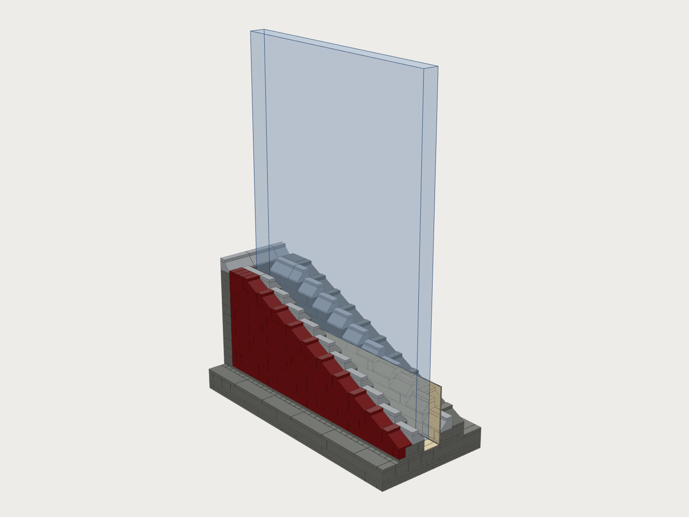
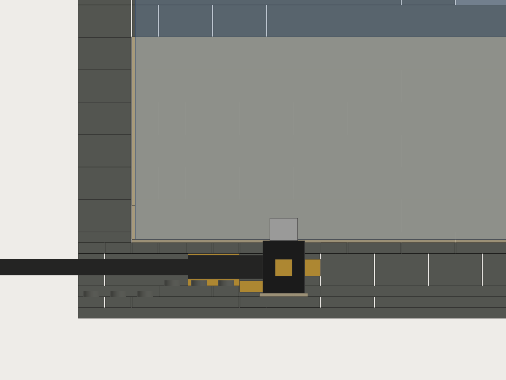
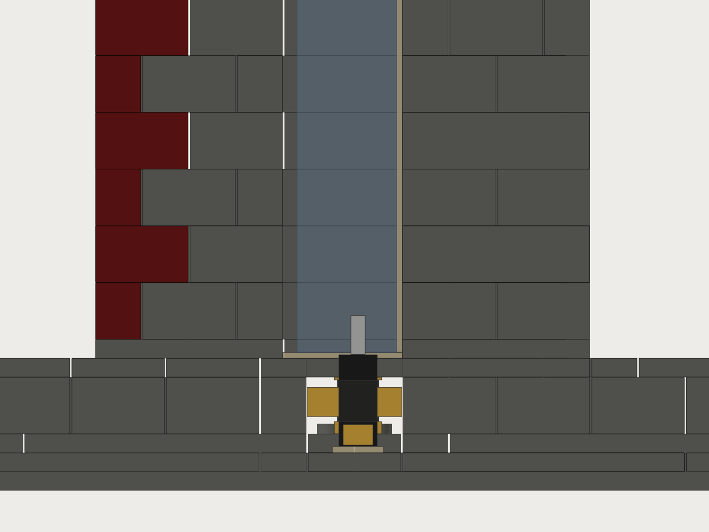
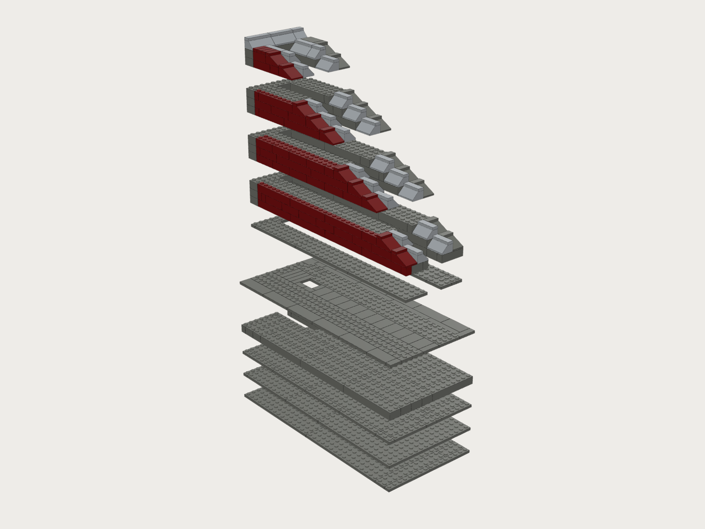

# Night Array laptop dock: LEGO version

A LEGO build of the Night Array **latch-free vertical dock** for an Apple Silicon **MacBook Pro 14" or 16"**. The laptop stands closed on its left side in a felt-lined slot. Its rear left Thunderbolt port drops onto a Newnex right-angle USB4 plug that stands tip-up in a foam-lined pocket under the slot floor. The laptop's weight seats it, and you lift it straight out. There is no latch, button or magnet.

The only non-LEGO parts are the Newnex cable itself, 3 mm EVA foam, 1 mm self-adhesive felt, 1 mm foam tape and double-sided tape. Nothing is 3D printed.



| | |
|---|---|
| Size | **16 × 35 studs = 128 × 280 mm** footprint. Back wall **144 mm** tall, side walls sweep down from 131 mm at the back to 45 mm at the front |
| Slot | **20.0 mm** (2.5 studs; 20.2 mm with real LEGO tolerances), open at the front, 264 mm long from the back wall. Floor at 22.4 mm above the desk |
| Laptop | 14" (15.5 mm) and 16" (16.8 mm) both fit the same build. Only the felt liners and the plug's foam pads change |
| Plug | Newnex U4T1C01CR5P010 side-exit head. Overmold face **0.39 mm below** the landing plane. Floats about ±2 mm on EVA pads. Cable runs straight out of the back at 15 mm height |
| Parts | **481 LEGO parts** (206 bricks, 140 plates incl. 76 jumpers, 45 slopes, 90 tiles), 61 part/colour lines |
| Colours | Dark Bluish Gray body (364), Light Bluish Gray lead-in slopes and crest (50), **Dark Red** outer panel on the left wall (67) |
| Estimated cost | **about $120** in LEGO on BrickLink (±40 %), plus the Newnex cable (about $65, already in the kit BOM) and about $10 of felt, EVA and tape |
| Stability | With a 2.15 kg 16" docked, it tips at **22.4° sideways** (needs ≥ 15°). The laptop alone, ignoring the dock's ~1.0 kg, would still give 17.3°. No ballast needed |

Everything is generated by [`../make_lego_dock.py`](../make_lego_dock.py) (plain `python3`, no dependencies). It imports the part table from `make_lego_base.py`, and its parameters are at the top of the script:

```
python3 night-array/kit/lego/make_lego_dock.py                   # 16", rear port: model, lists, checks, images
python3 night-array/kit/lego/make_lego_dock.py --model 14        # same LEGO, the ghost and the numbers for the 14"
python3 night-array/kit/lego/make_lego_dock.py --port tb_front   # plug in the front left Thunderbolt port instead
python3 night-array/kit/lego/make_lego_dock.py --no-render       # skip the images
```

The images come from [`../render_lego_dock.mjs`](../render_lego_dock.mjs), adapted from the base's renderer (headless Chromium and three.js from `night-array/viewer/node_modules`). It takes the output directory as an argument.

## Files

| File | What it is |
|---|---|
| `night-array-dock.ldr` | LDraw model with 12 build steps (one `STEP` each) and a comment per step. The dock's front faces LDraw −Z and the back wall is at +Z. Steps 5 and 12 have no LEGO parts: they are the plug and the liners. The plug, foam, felt and cable are not in the file |
| `parts.csv` | Part list: LDraw id, BrickLink id, name, colour (LDraw and BrickLink ids), qty, estimated price |
| `bricklink-wanted.xml` | BrickLink wanted-list upload (`ITEMTYPE P`, colours 85 / 86 / 59, `MINQTY`) |
| `bricks.json` | Every part as a box in mm. It uses the same schema as `../bricks.json`, with one extra key on slope parts: `slope {down, high_mm, lip_mm}`. Frame: **x right as you face the front of the dock, y depth toward you (0 = back edge), z up (0 = desk)**, origin at the back-left-bottom corner. `reference` holds the laptop, the plug head, tongue, boot and cable, the EVA pads, the felt and the back liner |
| `checks.json` | Self-check results, the vertical numbers, and the **plug and liner settings for both laptops** |
| `steps/step-01.png` … `step-12.png` | The build so far after each step. New parts have orange outlines and earlier parts are faded |
| `overview.png`, `exploded.png` | Assembled view with the laptop ghosted, and the exploded view |
| `plug-section-side.png`, `plug-section-front.png` | Cuts through the plug centre, along the slot and across it. Black is the Newnex head, grey is the USB-C tongue, yellow is EVA or foam tape, tan is felt, blue is the laptop |

Open the model in **BrickLink Studio** (*File → Import → Import LDraw file*), **LeoCAD** or **LDCad**. To buy the parts, upload `bricklink-wanted.xml` (*Want → Wanted Lists → Upload*), as for the base.

## How the laptop sits

Looking at the dock from the front:

- The laptop stands **closed on its LEFT side**, with the MagSafe and both Thunderbolt ports facing down. The **hinge is toward the back**.
- Its **bottom face (rubber feet) is against the RIGHT wall**. That wall is the reference wall: it is on the LEGO grid and carries one 1 mm felt liner.
- The **lid faces the LEFT wall**. That wall is the Dark Red one, standing half a stud off the grid on jumper plates.
- The **rear edge rests against the back wall**, on the back liner.
- The plug enters the **rear left Thunderbolt port** (the one next to MagSafe). Use `--port tb_front` for the other one.

So the plug's position across the slot is:

> right wall face (72.1 mm) − right felt (1.0) − feet (0.6) − **port centre height above the bottom face**

Its position along the slot is:

> back wall face (16.1 mm) + back liner + **port centre distance from the rear edge**





## Port positions: what is assumed, and how to measure yours

Apple does not publish a dimensioned drawing of the side of the MacBook Pro. A web search turned up no measured port coordinates either: not from Apple's spec pages, Apple's accessory guidelines, iFixit, the MacRumors port overview or the Apple wiki pages. **The numbers in the script are estimates**, scaled from Apple's left-side product photos against the published body sizes. Treat them as **±3 mm along the side and ±1 mm in height**:

| | 14" (312.6 × 221.2 × 15.5 mm, 1.6 kg) | 16" (355.7 × 248.1 × 16.8 mm, 2.15 kg) |
|---|---|---|
| MagSafe centre from the rear edge | 23 | 25 |
| **Rear Thunderbolt** centre from the rear edge | **41** | **44** |
| Front Thunderbolt centre from the rear edge | 55 | 58 |
| **Port centre height above the bottom case** | **5.4** | **5.9** |
| Rubber feet height (`FEET_H`) | 0.6 | 0.6 |

The plug floats about ±2 mm, so these estimates are probably close enough to start. **Measure your own laptop before setting the plug.** It takes five minutes:

1. **Port distance from the rear edge.** Close the laptop and lay it flat. With calipers, or a steel ruler read under a magnifier, measure along the left side from the rear (hinge) face to the near edge of the port opening and to its far edge. Average the two. The opening is about 8.9 mm long, so the two readings should differ by about 9 mm.
2. **Port height above the bottom face.** Stand the closed laptop on its feet on a flat table. Measure from the table up to the bottom edge of the port opening and up to its top edge, using the calipers' depth rod or a ruler held square. Average the two. That is the height above the *feet*.
3. **Feet height.** Measure from the table up to the bottom case surface, just beside a foot. Subtract it from step 2 to get the port height above the bottom face, and keep it as `FEET_H`.
4. **Thickness across the feet** (`T`). Measure with calipers over the closed laptop, across the feet.
5. Put the numbers into `MODELS` (`ports_from_rear`, `port_h`, `T`) and `FEET_H` at the top of `make_lego_dock.py`. Run it again. `checks.json → settings` then gives the back liner thickness, the felt layers and the four foam pad stacks for your laptop.
   - If the port moved more than about 4 mm along the slot, the script moves the pocket by whole studs. Rebuild steps 2–6 around it: they are only 2 × 6 studs.

## Building it



| Step | Layer (z, mm) | What |
|---|---|---|
| 1 | L0 (0–3.2) | **Base plates** over the whole 16 × 35 footprint (3 × Plate 16 × 16 and others) |
| 2 | L1 (3.2–6.4) | Second plate layer. Its seams cross the first. The smooth **Tile 2 × 3** at studs x 7–8, rows 6–8 is the **plug seat**: its top, at 6.4 mm, is the reference for the plug height |
| 3 | L2 (6.4–9.6) | Plate layer with the 2 × 3 **pocket** and the open cable channel to the back edge. The plates left inside the channel, in the 3 rows behind the pocket, are the **boot saddle** |
| 4 | L3–L5 (9.6–19.2) | Brick course around the pocket and the **cable channel**: 16 mm wide, 12.8 mm tall, straight out of the back edge |
| 5 | — | **Fit the plug** (see below) |
| 6 | L6 (19.2–22.4) | **The floor.** Lay the **4 × Tile 1 × 4 roof tiles** across the channel first: each one grips a stud on both sides and is later pinned down by both walls, and they hold the plug down. Then the **76 jumper plates** under the left and back walls (one stud each, half a stud off the grid), the slot floor tiles, the plates under the right wall and the plinth tiles |
| 7 | L7 | **Wall plates.** The left and back walls go on the jumpers' centre studs, half a stud to the right of the grid, which makes the 2.5-stud slot. The right wall is on the grid |
| 8–11 | L8–L43 | **Wall courses 1–12.** The Dark Red outer skin of the left wall alternates 1 and 2 studs thick, which bonds it to the gray inner skin. Each 3-row step of the sweep is capped with a **Slope 33 3 × 2** on the outer 2 studs (falling to the front) and a **Slope 45 2 × 3** on the inner 2 studs (falling into the slot: the **lead-in**). Tiles cover the studs. The back wall is one course taller and ends in a Light Bluish Gray **45° crest** |
| 12 | — | **Liners and plug setting** (see below) |

Build notes:
- Press every layer down hard across its whole area, especially steps 1–2. The left wall stands on single jumper studs, so press each wall plate in step 7 firmly onto its jumpers.
- **The roof tiles (step 6) are what stop the plug coming out with the laptop.** Before you start the walls, check that each one is seated on its two end studs.
- The left wall and the back wall are bonded to each other. The right wall is on the other half-stud grid, so it meets the back wall at a plain seam and is tied only through the base. That is fine for a dock, but don't lift the dock by the right wall.
- Slopes need nothing on top of them. The tiles on the stud rows are only cosmetic.

## Fitting and setting the plug (step 5)

You need the Newnex cable, 3 mm EVA, 1 mm foam tape, 1 mm self-adhesive felt, a sheet of printer paper and a craft knife. The numbers below are for the **16"** with the estimated port position. The 14" numbers are in brackets. The script prints both, and `checks.json → settings` has them.

1. **Seat.** Stick a 9 × 15 mm piece of 1 mm felt on the seat tile in the bottom of the pocket, and one piece of paper (0.1 mm) on top of it.
   - This is the **same felt** as on the floor, so its thickness cancels out. The LEGO between the seat and the floor top is exactly 16.0 mm (5 plates). The head is 15.51 mm. The paper sets the remaining gap: 16.0 + 1.0 − 1.0 − 0.1 − 15.51 = **0.39 mm**, which is how far the overmold face sits below the felt surface the laptop lands on.
2. **Head in.** Put the head in the pocket **tip up**, with the **cable leaving toward the back**. USB-C is reversible, so turn the head 180° if the cable points forward. The plug's wide side runs along the slot.
3. **Foam pads.** Cut four pads with 5 × 5 mm faces from EVA, foam tape, or a stack of both, and push them into the gaps around the head at mid-height. Keep them small: the smaller the pads, the softer the centring.
   - **Left** (lid side): 2 × EVA (gap 5.4 mm). [14": 2 × EVA + 1 tape, gap 5.9]
   - **Right** (feet side): 1 × EVA + 2 × tape (gap 4.2 mm). [14": 1 × EVA + 1 tape, gap 3.7]
   - **Front** (closed end): 1 × EVA + 2 × tape (gap 4.7 mm). [14": 2 × EVA, gap 5.7]
   - **Back**: under the boot, 2 × EVA + 2 × tape (gap 6.9 mm). [14": 2 × EVA + 1 tape, gap 5.9]

   Each pad is cut about 0.5 mm thicker than its gap, so the head is lightly held and can float about ±2 mm in every direction.
   - These stacks also put the plug where the port will be. The head sits **0.6 mm right of** and **1.1 mm in front of** the pocket centre for the 16". For the 14" it is 1.1 mm right and 0.1 mm forward.
   - Stick each pad to the LEGO with a dot of double-sided tape, **not to the head**. The head must be free to slide and tilt a little.
4. **Boot clamp.** Lay a strip of 3 mm EVA (8 × 15 mm) on the saddle plates behind the pocket, and put the boot on it. Stick a strip of 1 mm foam tape on the boot's top.
   - When the roof tiles go on in step 6, they squeeze the boot lightly (about 0.5 mm) between the saddle and the roof.
   - This is the plug's only hold-down. When you lift the laptop, the USB-C extraction force (8–20 N) pulls the head up against the roof.
5. **Cable.** Lead the cable straight back through the channel and out of the back edge. It has no bend inside the dock. Behind the dock it drops 13 mm to the desk in a gentle S-bend, so **leave at least 40 mm free behind the dock**. That keeps the bend radius at 25 mm or more.

## Liners and the seating test (step 12)

1. **Floor:** 1 mm felt over the whole slot floor, with an 11 × 17 mm window cut over the head. The window must clear the head's 6.5 × 12.35 mm face plus its ±2 mm float.
2. **Right wall** (where the laptop's feet go): one layer of 1 mm felt, at least 60 mm tall, along the whole slot.
3. **Left wall:** nothing for the 16", which leaves 2.4 mm of total side clearance. For the 14", two layers of 1 mm felt, which leaves 1.7 mm.
4. **Back wall:** 1 mm felt for the 16". For the 14", a 3 mm stack of felt plus 2 × 1 mm foam tape. This liner sets where the laptop sits along the slot, so it puts the port over the plug.
5. **Straightedge check.** Lay a steel rule across the slot floor over the plug. The rule should not touch the plug face: you should be able to slide one sheet of paper (0.1 mm) between them, but not three (0.3 mm). If three sheets slide in, the face is too low: add a paper shim under the head. If the rule rocks on the plug, the face is too high: remove the paper shim.
   - Aim for the face 0.3–0.5 mm below the felt surface. The pads compress a little in use, so don't aim lower than that.
6. **Seating test.**
   1. Hold the laptop closed and upright on its left side, hinge to the back, feet toward the right wall.
   2. Rest its rear edge against the back liner, high up.
   3. Lower it straight down, keeping the feet lightly against the right wall's felt.
   4. In the last 7 mm, the port should find the plug and the laptop should **sink home under its own weight**, or with a light press of no more than about 1 kg (10 N) at the top edge. The charging chime or the external displays waking up confirm it.
   5. **It must land on the felt, not on the plug.** With the laptop seated, push down gently on its top edge. Nothing should give.
7. **Lift-out test.** Lift the laptop straight up with one hand at the top centre. It should come free with a steady pull (its weight plus 8–20 N). The plug must stay in the dock.

## Troubleshooting

| Symptom | Cause and fix |
|---|---|
| The laptop stops 1–3 mm high and won't seat | The tongue is hitting beside the port. Find which way it is off: look along the slot, or put a dab of chalk on the plug face and lower the laptop once. Swap 1 mm of foam from one side pad to the other, which moves the head 1 mm. Shift the laptop instead with felt on the right wall (laptop moves left) or a thicker back liner (laptop moves forward) |
| It seats only with a hard push | The pads are too stiff. Cut them smaller (3 × 3 mm), or take 1 mm out of each stack. Check that no pad is taped to the head, and that the floor felt window isn't pinching the head |
| It rocks, or rests on the plug | The face is too high. Take the paper shim out, or cut the felt under the head thinner than the floor felt. Then repeat the straightedge check |
| The display drops out when you touch the laptop | The face is too low (the plug isn't fully in). Add a paper shim. If the laptop leans, also check that its feet are against the right wall felt |
| The plug comes up with the laptop | The boot clamp is loose. Add a layer of foam tape on the boot's top, or a thicker EVA strip under it, and check that the 4 roof tiles are fully down. Press both walls down onto them |
| A different MacBook | Measure it (see above), put the numbers in `MODELS`, run the script again, and follow `checks.json → settings`. Laptops 15–18 mm thick fit this slot with liners. A thinner one needs more felt on the left wall |

## Self-checks (`checks.json`)

The script exits non-zero if any check fails. All of these pass for both laptops and both ports:

- **Every layer is packed exactly:** 45 plate layers, checked on a half-stud (4 mm) grid with no holes or overlaps, against an occupancy worked out separately from the design rules.
- **Every part is in the part table.** The ids were checked against library.ldraw.org.
- **Every stud lands in a socket.** No stud of the on-grid parts sits under a half-stud-shifted part. The 6 left-wall and back-wall plates rest only on the jumpers' centre studs.
- **All 481 parts form one stud-connected assembly**, and none is held from above only.
- **Slot and clearance:** 20.0 mm nominal and 20.2 mm real. Total side clearance is 2.4 mm for the 16" (felt R 1.0, L 0) and 1.7 mm for the 14" (R 1.0, L 2.0). The slot is 264 mm long, against the 16"'s 249 mm with its back liner.
- **Plug on the port.**
  - 16": port at x 64.6, y 61.1; head 0.6 mm right and 1.1 mm forward of the pocket centre; gaps (left/right/back/front) 5.4/4.2/6.9/4.7 mm.
  - 14": port at x 65.1, y 60.1; head 1.1 / 0.1 mm off centre.
  - Float is at least 2 mm on every side.
- **Overmold face 0.39 mm below the landing plane.**
- **Plug hold-down:** the 7 mm boot (assumed) is clamped between the saddle (2.1 mm gap, 3 mm EVA) and the roof tiles (0.5 mm gap, 1 mm foam tape).
- **Cable:** straight for 33 mm behind the boot, with no bend inside the dock. The 25 mm S-bend to the desk needs 33 mm behind the dock.
- **Tipping:** 22.4° left, 23.4° right, 44° front and 41.5° back with the 16" docked. The 14" gives 26.2°.
- **Wall height:** 109 mm above the floor at the back, 70 mm at the laptop's centre, 22 mm at the front. The back wall is 122 mm above the floor.

## What's uncertain

- **Port positions are estimates.** Measure your laptop first (above). The ±2 mm float and the liners cover small errors, not the ±3 mm guess.
- **The boot.** The Newnex drawing gives the head (12.35 × 6.5 × 15.51 mm), the tongue and the 7.8 mm cable height, but not the strain-relief boot's diameter. The script assumes 7 mm. A thinner boot needs more foam in the clamp; if it is thicker than 7.5 mm, leave out the foam tape on top.
- **Centring force.** EVA craft foam stiffness varies a lot. If the plug resists centring, make the pads smaller. The research target is no more than about 2 N of side force per mm.
- **Self-seating.** A 2.1 kg 16" (21 N) is heavier than the worst-case USB-C insertion force (20 N), so it should seat by itself. A 14" (15.7 N) may need a light press.
- **The right wall** is joined to the back wall only through the base, because of the half-stud split. The left wall stands on single jumper studs. Both are fine in normal use; don't pick the dock up by its walls.
- **The jumper.** The BrickLink and LDraw id is 15573. LDraw calls this mould "without Understud", and older 3794b jumpers are the same shape. Either works.
- **Dark Red availability.** Every Dark Red part is a common brick, slope or tile. If a shop is short of Dark Red 1 × 8 bricks, two 1 × 4s work the same. If Dark Red is hard to find, Dark Bluish Gray works everywhere.
- **Prices** are rough BrickLink averages (±40 %). Dark Red is costed at 1.8× gray.
- **Mass** (~1.0 kg) and therefore the tipping angles are estimates from typical part weights. Even ignoring the dock's weight entirely, the 16" still gives 17.3°.
- The images are simple box and wedge renders. Open the `.ldr` in Studio for a true-to-part view.
