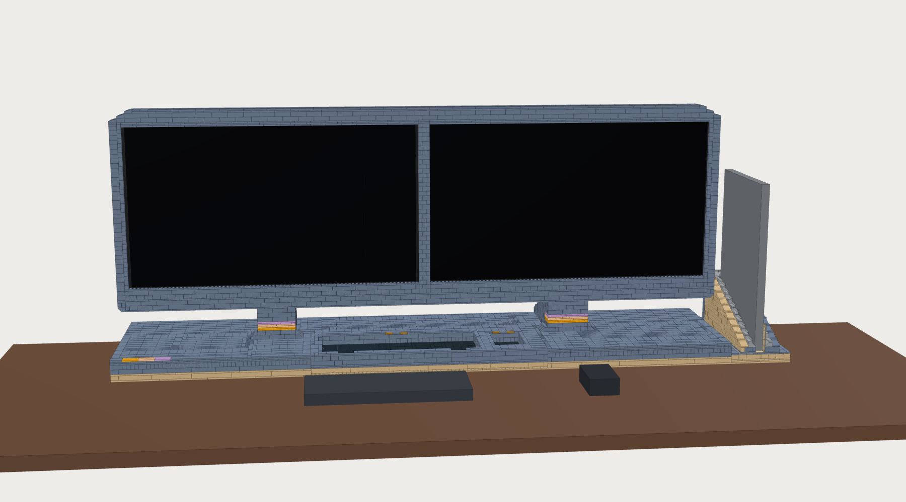
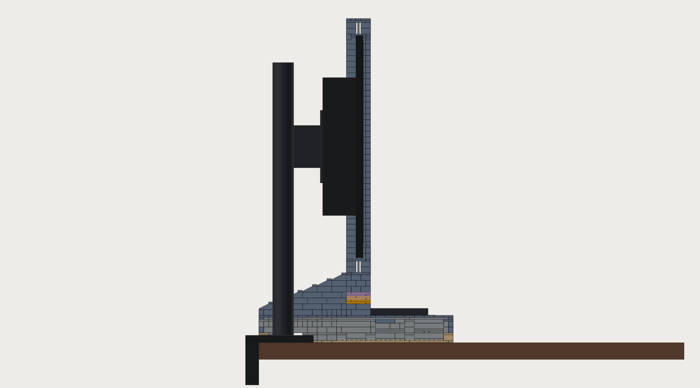
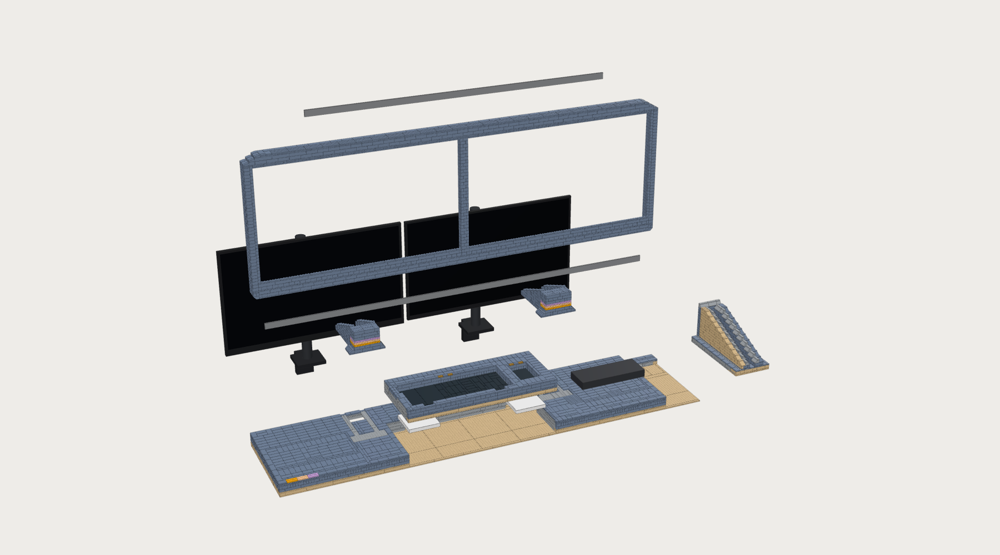

# Night Array station: the full LEGO build

The whole Night Array desk station in LEGO: a long hollow base with the keyboard and mouse charging pockets, two short necks, one brick-built frame round two 27" screens with a centre seam, and the laptop dock at the right end. Sand Blue with a Tan lower band, black pocket floors, gold charge marks and pastel accents, after the concept image.



Everything here is generated by [`../make_lego_station.py`](../make_lego_station.py). It reuses the pocket tray from [`../make_lego_base.py`](../make_lego_base.py) and the dock from [`../make_lego_dock.py`](../make_lego_dock.py); read [`../README.md`](../README.md) and [`../dock/README.md`](../dock/README.md) for those two parts, because their fitting instructions (pads, foam, Newnex plug, felt) are unchanged and are not repeated in full here.

**The one rule the design is built round: LEGO never carries a monitor.** Each monitor hangs on a steel VESA pole mount that is clamped to the desk. The necks and the frame are cladding.

## At a glance

| | Full | Lite (`--lite`) |
|---|---|---|
| Size | 1408 × 320 × 534 mm (176 × 40 studs) | same |
| LEGO parts | **5,217** in 140 part/colour lines | **4,469** |
| LEGO cost (estimate, ±40 %, no shipping) | about **$1,310** | about **$1,130** |
| Parts that are not LEGO | about **$116** ([list](non-lego-parts.md)) | same |
| LEGO weight (estimate) | 7.7 kg | 7.3 kg |

Lite leaves the Sand Blue tiles off the deck except for a two-stud border, so the deck is Light Bluish Gray with studs showing ([picture](lite/overview.png)). Everything else is the same. Its files are in [`lite/`](lite/).

| Section | What it is | Parts | Est. cost |
|---|---|---|---|
| base | floor, outer wall, hidden ribs, deck plates, deck tiles, strip behind the dock | 2,025 (lite 1,325) | $583 (lite $411) |
| pockets | the keyboard + mouse pocket block with the pad cavities | 784 | $212 |
| dock | laptop dock | 668 | $132 |
| necks | two necks | 378 | $84 |
| frame | screen frame | 1,362 | $300 |

By colour (full): Sand Blue 3,528, Light Bluish Gray 1,219 (all hidden except where noted below), Tan 327, Black 58, Light Nougat 37, Lavender 26, Bright Light Orange 18, Pearl Gold 4.

The station is 1.41 m wide because two 27" monitors side by side are 1.24 m and the dock stands beside them. The keyboard and mouse pockets are the real size of the Keychron K3 Ultra and the Lenovo X9, so they look smaller against the base than in the concept image.

## Files

| File | What it is |
|---|---|
| `night-array-station.ldr` | LDraw model (MPD inside one `.ldr`): a main model plus one submodel per section (`station-base.ldr`, `-pockets`, `-dock`, `-necks`, `-frame`), with STEPs. Opens in BrickLink Studio, LeoCAD, LDCad |
| `parts.csv` | every part/colour line with quantity, estimated price and how many LEGO sets contain that part in that colour |
| `bricklink-wanted.xml` | BrickLink wanted list: Wanted → Upload → paste |
| `bricks.json` | every part as a box in mm, same schema as [`../bricks.json`](../bricks.json) and [`../dock/bricks.json`](../dock/bricks.json), plus `section` on each brick; `reference[]` holds both monitors, the stands, bars, keyboard, mouse, pads, Plugable box and laptop |
| `non-lego-parts.md`, `.json` | stands, bars, stand-offs, felt, foam, with prices; pointers into [`../../parts.json`](../../parts.json) for the electronics |
| `checks.json` | the 20 self-checks, sizes, part count and cost by section |
| `part-colour-availability.json` | which part exists in which colour (Rebrickable set inventories, 2026-11-11); the script only uses a part in a colour that at least 5 sets contain |
| `overview.png`, `back.png`, `exploded-sections.png`, `section-neck.png`, `steps/step-01…16.png` | renders |
| `lite/` | the same files for the lite variant |

## Your two monitors: what was found, and what you must confirm

The opening for each monitor is cut to that monitor, so the numbers matter to about 1 mm. **Measure both monitors before you order bricks.**

| | Left (default) | Right (default) |
|---|---|---|
| Model used | **Acer KB272 EBI** (`UM.HK2AA.E02`) | **Sceptre E275W-FPT** |
| Why this one | "KB272" with no suffix: the EBI is the common US model | the label says "F27". No Sceptre page uses that name. One marketplace listing calls a 27" FHD 75 Hz HDMI ×2 + VGA Sceptre "F27", which matches the E275W-FPT family |
| Housing W × H | 614.7 × 367.1 mm | 612.6 × 359.2 mm |
| Depth | 66.7 mm at the rear bulge | 28 mm at the edge; **45 mm at the bulge is a guess** |
| Weight without stand | 4.73 kg (may include the stand; then about 3.4 kg) | 3.00 kg |
| VESA | 100 × 100 (one review says 75) | 100 × 100, M4 × 10 |
| Power | internal supply, AC cord (to confirm) | external 12 V 3 A adapter |
| Ports | HDMI 1.4 + VGA, rear, plugs point down | 2 × HDMI + VGA + audio, rear |
| Confidence | medium | medium-low that it is your model; the E275W-FPT figures themselves are Sceptre's |
| Sources | acer.com product page, Acer store, devicebeast, displayninja | sceptre.com support sheet and product page |

Other variants are already in the `MONITORS` block: `acer_kb272_e0bi` (newer slim chassis, 611.5 × 361.3 × 45.2 mm, external adapter; low confidence), `sceptre_e275w_fpt1`, `sceptre_e275w_19203rs` (VESA **75**, internal supply, 4.3 kg) and `sceptre_e275w_19203rd` (thick bezels, 623.8 mm wide).

Measure and confirm, for each monitor:

1. The exact model on the rear label (full string with the suffix).
2. Housing width and height without the stand, to 0.5 mm.
3. VESA holes: are there four threaded holes on the back, and are they 75 or 100 mm apart?
4. `vesa_to_front`: from the flat face the VESA plate bolts onto to the front glass.
5. `top_edge_depth`: how thick the housing is along its top edge.
6. Bezels: from the housing edge to the first lit pixel at the sides, top and bottom (show a white screen).
7. Where the ports and the buttons are, and which way the plugs point. If the buttons are on the bottom edge, tell the script (`"buttons": "bottom"`) and leave a finger gap in the bottom beam under them.
8. Internal power supply or external brick.

Then edit the `MONITORS` block at the top of `make_lego_station.py` (or add a new entry) and run:

```
python3 night-array/kit/lego/make_lego_station.py --left <key> --right <key>
```

The frame width, base width, both openings, the bezel lips, the necks, the stand-offs and every check follow from that block. The script exits non-zero if a check fails.

**Taking the Sceptre apart: don't.** There is no benefit, because the LEGO bezel already hides the housing. An opened monitor exposes the backlight driver and, on models with an internal supply, mains; the panel's edge is fragile without its housing; and a bare panel has no VESA mounting points, so nothing safe would be left to hang it from. The design assumes two whole monitors.

**If a monitor has no VESA holes.** All the candidate models above have them. If yours does not, use a clamp-on adapter (for example VIVO `MOUNT-UVM01`, $39.99) between the monitor and the pole mount. Its arms grip the top and bottom edge of the housing, so three things change: raise the top and bottom clearance for that opening so the arms fit (the opening check will then need its limit widened), expect the retaining lips to move or go, and add the adapter's thickness to `vesa_to_front`.

## How the monitors are mounted



Chosen structure: **two VIVO `STAND-V001C` single-monitor pole mounts, one per monitor, clamped to the back edge of the desk.** $34.99 each; steel pole 17.7 in (450 mm), fixed tilt bracket, rated 17.6 lb (8 kg), VESA 75 and 100, C-clamp for desks 10–88 mm thick or a grommet bolt through a hole. The monitors are flat, in one plane, with no toe-in.

Why this one:

- A freestanding stand (VIVO `STAND-V001H`) has a V-shaped steel foot 15.5 × 11 in that would lie under the charging pads, inside the 20 mm steel keep-out, and it cannot resist a 50 N push at the top of the screen by itself.
- One dual stand (VIVO `STAND-V002F`) has one centre pole, so it gives no pole to put inside either neck, and the same foot problem.
- With clamped poles the desk takes the load. The checks give: 50 N at the top of the screen plus the monitor's own weight is about 30 N·m at the clamp, which is 660 N in the clamp screw (margin ×7.5 on an assumed 5 kN) and 24 MPa in the pole (×10). A 10° tilt alone is 7 N·m.
- Not clamped, the same push would tip the whole station away from you (margin ×0.98), and only if LEGO held the poles. So the clamps, or the grommet bolts, are mandatory.

How it goes together:

- The base's back edge sits on the desk's back edge. Each pole stands about 40 mm in from that edge, inside a clamp bay: a 112 × 96 mm gap in the floor with a 22 mm high doorway in the back wall, so the clamp plate sits on the desk itself, not on LEGO.
- The pole comes up through a hole in the deck (6 or 7 studs wide, 7 long) between the two cheeks of the neck, with at least 6.5 mm of air all round. Push a ring of foam between pole and cheeks.
- The bracket holds the VESA plate at about 323 mm above the desk. The thinner monitor gets four M4 stand-offs (22 mm with the default numbers) so both glass faces are in one plane, 4.3 mm behind the bezel bricks.
- The frame stands on the two pedestals. It does not touch the monitors: 1.7–2.7 mm of air round each housing (the left opening needs a 2 mm felt strip on each side face, because the stud grid would otherwise leave 4.65 mm). The bezel lips overlap the black border of each screen without reaching the picture.
- The frame cannot fall forward: three short blocks under the top beam hang 9.6 mm down behind each monitor's top edge. Pad them with foam to leave about 2 mm.
- LEGO alone would sag over 1.28 m, so each beam has an aluminium flat bar on edge in a slot one stud wide and two bricks high: 48 in in the bottom beam, 36 in in the top beam. Deflection with the bars is about 0.2 mm.
- The frame is 40 mm deep and has no back, so the monitors' vents, ports and rear buttons stay open, and nothing is sealed over an internal power supply.
- The housings are 14 mm apart (one stud of web plus clearance), so the pictures are about 30 mm apart. Without the web it would be about 20 mm, but the top beam would lose its centre support.

A 50 N push on the LEGO frame itself will shift the frame until it bears on the monitor's edge; the monitor then takes it into the pole. The frame is cladding and can be knocked loose; the monitors cannot.

## The base



- **Pocket block** (61 × 26 studs, in the middle, centred on the seam between the screens): exactly the tray of the pocket-base build. Keyboard pocket 41 × 16 studs, mouse pocket 8 × 13, one Anker 313 pad under each in a 13 × 13 cavity, one 3.2 mm layer of black 8 × 16 tiles between pad and device, cable channels to the back. The same pad checks pass.
- **Hollow part**: an outer wall two studs thick, a spine wall 12–16 studs in from the back, a second line of support at row 30, a few ribs, deck plates on top, deck tiles on those. 35 mm clear inside.
- **Three removable lids** (deck plates held together by their own tiles; nothing bridges out of them): over the Plugable bay at the right, over a spare bay at the left, and over the rear zone between the necks where the pad cables run.
- **Plugable UD-6950PDH**: in the right bay, 240 × 176 mm, against the spine wall, with 91 mm of cable space in front of it under a beam on two posts.
- **Power strip**: the Tripp Lite strip (610 mm) does not fit between the clamp bays. Keep it, the dock's 130 W brick and any monitor adapter outside, behind or under the desk. No mains enters the LEGO.
- **Cable exits**: the two clamp doorways, two 4-stud doors in the back wall, and the dock's own channel through the strip behind it.
- **Dock**: the dock build, repacked with parts that exist in Sand Blue, Tan outer panel, standing on the shared floor plates at the right end. Plug seat, pocket, saddle, roof tiles and liners are unchanged (overmold face 0.39 mm below the landing plane).

## Colours and where Sand Blue was not possible

Sand Blue is a limited colour. The script only uses these in it: bricks 1×1, 1×2, 1×4, 1×6, 2×2, 2×3, 2×4; plates 1×1, 1×2, 1×3, 1×4, 2×2, 2×3, 2×4, 2×6, 4×6; tiles 1×1, 1×2, 1×3, 1×6, 2×2, 2×3, 2×4; slopes 33° 3×2, 45° 2×1, inverted 45° 2×1, curved 2×1 and 2×2. The least common lines are in 6–7 sets each (Brick 2×3, Plate 2×6, Tile 2×3, inverted slope in Sand Blue; Plate 1×3 in Lavender; Plate 4×10 in Bright Light Orange); `parts.csv` has the count for every line, so you can see what may be slow to find.

Light Bluish Gray is used for everything hidden (ribs, inner wall row, deck plates, core of the pocket block), and in four visible places:

- the two 1 × 16 lintels over the clamp doorways at the back, with a 2 × 16 plate on them;
- the dock's jumper plates and its 1 × 4 roof tiles (no Sand Blue version; the tiles are under felt);
- the dock's lead-in slopes and their tiles, which are the dock's light liner colour by design;
- the deck, in the lite variant.

The rounded frame corners are three steps of curved slopes at the top and inverted 45° slopes at the bottom, because the inverted curved slope barely exists in Sand Blue. The base's corners are square.

## Build order

One picture per step is in [`steps/`](steps/). The LDraw file has the same steps inside each section.

1. **Floor.** Tan plates over the whole footprint, including under the dock. Leave the two clamp gaps.
2. **Pocket block, lower half.** Plates, then bricks and plates round the two pad cavities.
3. **Hollow base walls and ribs**, and the strip behind the dock. Leave the clamp bays open at the back.
4. **Not LEGO.** Clamp both poles to the desk through the bays. Foam and pads into the cavities, micro-USB edge toward the channel. Plugable box into the right bay. Run the cables.
5. **Charging floor.** The three 8 × 16 tiles over the pads first, then the rest of the pocket floors.
6. **Pocket walls.**
7. **Deck plates.** Build each lid as its own group.
8. **Top tiles**, gold marks, pastel patches.
9. **Dock, lower part**, and fit the Newnex plug as in the dock build.
10. **Dock walls.**
11. **Necks**, round the poles.
12. **Not LEGO.** VESA plates onto the monitors (stand-offs on the thinner one), hang them, set height and level. Both should end up 2–3 mm above the line of the frame's bottom beam.
13. **Frame bottom beam** on the pedestals, 48 in bar in its slot.
14. **Frame sides, web and bezel lips.**
15. **Top beam**, 36 in bar, retaining lips, corners.
16. **Liners and devices.** Felt in the dock, foam on the retaining lips, felt dots inside the bezel corners, then laptop, keyboard, mouse.

## Cable routing

- **Pads**: each pad's cable leaves its cavity through the channel to the rear zone, then along it to the USB charger outside. Lift the rear lid to reach them.
- **Monitors**: video cables drop from the rear bulge behind the frame's bottom beam, into the open channel between the cheeks of the neck, down beside the pole and out through the clamp doorway, or along the rear zone to the Plugable bay. Power leaves by the clamp doorway.
- **Dock**: the Newnex cable runs straight out of the back of the dock, through the channel in the strip behind it, and leaves the station at the desk edge. It then loops round (bend radius 25 mm or more, so 60 mm of room behind the desk edge, or let the loop hang below the desk top) and comes back in through the right-hand door in the back wall, along the rear zone and through the spine door to the Plugable box. That is about 0.85 m of the 1 m cable.
- **Plugable**: its brick stays outside; its DC lead and the monitor cables use the right-hand door.

## Safety

- No mains wiring by the builder, and no mains inside the LEGO. Power strip and power bricks stay outside where they can cool.
- Do not exceed the mount's 8 kg per monitor. Both default monitors are well under.
- The clamps need a desk edge that is 10–88 mm thick, solid, and free at the back. On a glass or hollow-core top use a different mount.
- Keep metal away from the pads: the nearest metal in this design is 80 mm from a pad.
- The frame is not a handle. Move the station in sections: lift the frame off first, then the monitors, then unclamp.
- ABS softens with heat. Do not put a power brick in a closed bay, and do not close the back of the frame.

## Checks

All 20 pass (see `checks.json` for the numbers): layers packed exactly with no overlaps; every part in the table and available in its colour; every stud in a socket; one connected assembly, each section holding together on its own; pocket clearances; one tile layer over each pad; Qi keep-out; monitor openings 1.5–4 mm; nothing LEGO touching a monitor; retaining lips; pole clearance, height and rated load; LEGO-only tip angle (53° or more in every direction, laptop docked or not); frame balance; bar deflection; clamped-pole loads at 10° tilt and 50 N; Plugable bay; power strip; overall size; dock plug arrangement.

The LDraw placement of every part and orientation was also compared against the LDraw library geometry (111 combinations, no mismatch). That test needs network access and is not part of the script.

## What is uncertain

- **Both monitor models.** The Acer suffix and what Sceptre "F27" maps to are best guesses. A different chassis changes the openings by several mm.
- **Acer width**: 614.7 mm (Acer) against 612.4 mm (one database). With 612.4 the left opening becomes 77 studs and needs no felt liner.
- **Depths**: the Sceptre's 45 mm, both `vesa_to_front` values and both `top_edge_depth` values are estimates. They set the stand-off length and the foam on the retaining lips.
- **Bezels** are estimated from the active area; the lips are sized from them.
- **Stand dimensions** not published by VIVO: pole diameter (35 mm assumed), bracket depth (65 mm), clamp plate (100 × 90 × 12 mm) and how far in from the desk edge the pole stands (40 mm). They are in the `STAND` block. The clamp screw's 5 kN working load is an assumption too.
- **Button and port positions** on both monitors were not confirmed.
- **Weights and prices** of the LEGO are estimates. Prices are rough BrickLink averages with a ×2.2 factor for Sand Blue.
- **Part availability** comes from set inventories, not from live BrickLink stock.
- **The frame has not been built.** Its stiffness rests on the two bars and on the calculation above.
- Coil positions in the keyboard and mouse, and the MacBook port positions, carry the same uncertainties as in the base and dock builds.
