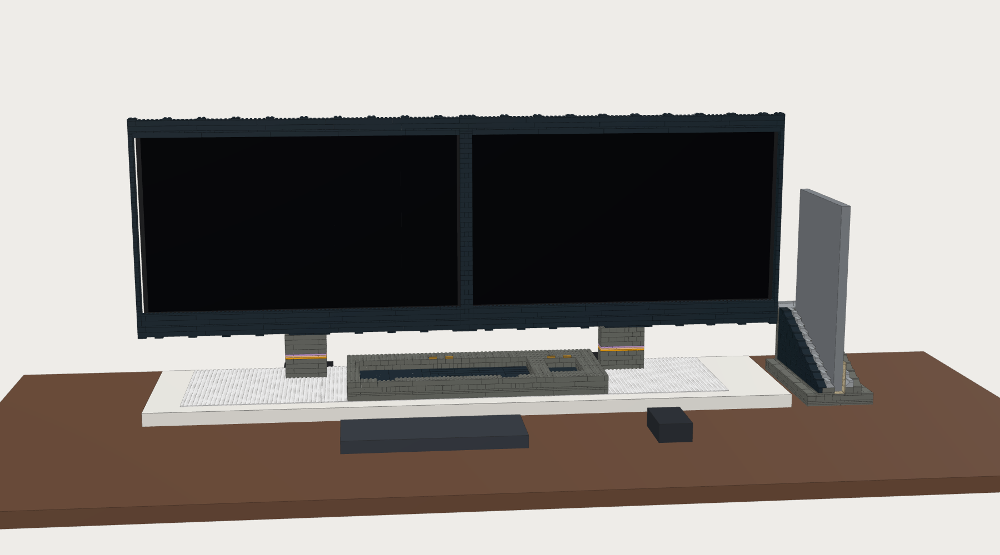

# Night Array station: budget LEGO build

The low-cost version of the [full LEGO station](../README.md). A bought shelf board and four baseplates replace the hollow LEGO base, the frame is a slim black border, and every brick is in whatever colour is cheapest for that part. About **1,435 LEGO parts for about $327**, against 5,217 parts and about $1,310 for the full build.

**Nothing needs cutting, sawing or drilling.** The board, the baseplates and both aluminium bars are used at the size they are sold in.

Generated by `python3 night-array/kit/lego/make_lego_station.py --budget`. The monitor block, the measuring list and the mounting rule are the same as in the full build; read [`../README.md`](../README.md) for those. LEGO still carries no monitor: both monitors hang on the two clamped VIVO poles.

## Shopping list: the parts that are not bricks

| Qty | What to buy | Size as sold | Price | Link |
|---|---|---|---|---|
| 1 | **IKEA BERGSHULT shelf, white, 120x30 cm** (article 304.212.35). The shelf only; no brackets | 1200 × 300 × 25 mm | about $25 (varies by country: CA $30, FI €19) | <https://www.ikea.com/us/en/p/bergshult-shelf-white-30421235/> |
| 4 | **LEGO White Baseplate 11026**, 32 × 32 studs | 255 × 255 mm | $7.99 each | <https://www.lego.com/en-us/product/white-baseplate-11026> |
| 1 | Double-sided mounting tape, 19–25 mm wide, 1 mm thick or less, 1.5 m or more | roll | about $6 | any hardware store |
| 2 | **VIVO STAND-V001C** single monitor desk mount | pole 450 mm, clamp for desks 10–88 mm | $34.99 each | <https://vivo-us.com/products/stand-v001c> |
| 1 | Aluminium flat bar 1/8 × 3/4 in, **48 in** | 3.2 × 19 × 1219 mm | about $9 | hardware store metal rack |
| 1 | Aluminium flat bar 1/8 × 3/4 in, **36 in** | 3.2 × 19 × 914 mm | about $7 | same rack |
| 1 | 4 × M4 male-female stand-offs, 22 mm, with M4 × 10 screws | | about $9 | fastener kit |
| 1 | Self-adhesive felt, 1 mm, and EVA craft foam, 3 mm | A4 sheets | about $15 | craft store |

Non-brick total about **$141**, plus the four baseplates ($32), which are counted with the LEGO below. The electronics are the ones already in [`../../../parts.json`](../../../parts.json).

The shelf was confirmed on IKEA's site by article number, size and 2.5 cm thickness; the US price was not shown to me, so check it. Any flat board 1200 × 300 mm and 25 mm or more thick does the same job. If you use a different one, put its size in the `BOARD` block and re-run; the script refuses a layout that does not fit.

## Size and cost against the full build

| Section | Budget parts | Budget cost | Full parts | Full cost |
|---|---|---|---|---|
| base | 4 baseplates | $32 | 2,025 | $583 |
| pockets | 362 | $102 | 784 | $212 |
| necks | 88 | $17 | 378 | $84 |
| frame | 472 | $74 | 1,362 | $300 |
| dock | 509 | $101 | 668 | $132 |
| **Total LEGO** | **1,435** | **about $327** | 5,217 | about $1,310 |
| Not bricks | | about $141 | | about $116 |

Overall 1392 × 395 × 535 mm: the frame is 1264 mm wide, the dock adds 128 mm at the right, and the board is 300 mm deep starting 95 mm in from the desk's back edge. LEGO weight about 3.1 kg.

Prices are the same rough BrickLink averages as the full build, ±40 %, without shipping. The dearest lines are 164 Dark Bluish Gray 2 × 8 bricks ($49), 96 black 1 × 16 bricks ($43), the four baseplates ($32) and the three 8 × 16 tiles over the pads ($21).

## Colours

Chosen per part for price and availability; only part/colour pairs that appear in 50 or more LEGO sets are used for the bulk.

- **Dark Bluish Gray** (766 parts): pocket tray, pedestals, dock body.
- **Black** (591): the frame, the pocket floors, the dock's outer panel and any dock part that is rare in Dark Bluish Gray.
- **Light Bluish Gray** (50): the dock's lead-in slopes and their tiles, as in the dock build.
- **White** (4): the baseplates.
- Accents, 24 parts, about $3: one Bright Light Orange, one Light Nougat and one Lavender plate layer in each pedestal, and four Pearl Gold tiles behind the pockets. The cream band is gone.

A black frame also hides the monitors' own black bezels.

## What changes against the concept picture

- **No blue.** Dark gray and black instead of Sand Blue; no cream lower band.
- **The base is a white shelf board** with a white studded field on it, not a blue brick body. It is 1.2 m wide, so the frame overhangs it by 32 mm each side.
- **The pockets are a separate low tray** standing on the board (rim 62 mm above the desk), not recesses in a flush deck. Its top shows studs; there are no rim tiles. The back of the tray sits under the screens.
- **The necks are two plain pedestals** in front of the poles. The poles themselves are bare and visible from the side and back.
- **The frame is a slim border**: 8 mm posts at the ends, 24 mm deep, with square corners and no side lips. The gap beside the left monitor (4.65 mm with the default numbers) is visible.
- **The dock stands on the desk** to the right of the board as its own piece, in gray and black.
- **The Plugable box lies on the desk behind the board**, between the two clamps. At 24.5 mm it is just lower than the board in front of it. Cables hang behind the desk edge.

Still there: two screens in one frame with a centre post, two necks with pastel stripes, a keyboard pocket and a mouse pocket with gold marks, the laptop standing in its dock at the right.

## How it goes together

Pictures for each step are in [`steps/`](steps/).

1. **Clamp, board, baseplates.** Clamp the two poles to the desk edge. Lay the shelf on the desk 5 mm in front of the clamp plates, centred between the poles' outer sides (it starts 32 mm in from where the frame's left end will be). Stick the four baseplates on it in a row, edges touching, 9 mm from the shelf's back edge, 64 mm from its left end and 112 mm from its right end (the row is off-centre on purpose, so that the tray and a pedestal each sit across a joint). Put a row of bricks across each joint while the tape sets so the studs stay in pitch. Plugable box on the desk behind the shelf.
2. **Tray, lower part.** Brick ribs round the two 13 × 13 pad spaces and their cable channels, then one layer of plates. Drop each Anker pad in. It stands directly on the baseplate studs: no foam under it.
3. **Charging floor and walls.** The three black 8 × 16 tiles over the pads, black tiles on the rest of the pocket floors, plates under the walls, two brick courses of wall, four gold tiles.
4. **Pedestals.**
5. **Monitors** onto the poles (not LEGO), stand-offs on the thinner one.
6. **Frame, lower part.** Cross plates on the pedestals, two rails with the 48 in bar standing between them, cross plates on top, then the end posts, the post between the screens and the bottom bezel strips.
7. **Frame, top.** Cross plates, including the six long ones that carry the hooks behind the monitors' top edge; two rails with the 36 in bar; the top bezel strips.
8. **Dock**, exactly as in [`../../dock/README.md`](../../dock/README.md), on the desk to the right.
9. **Liners and devices.** Felt in the dock, foam on the hooks (6 mm left, none right with the default numbers), laptop, keyboard, mouse.

The tray and the two pedestals each straddle a joint between baseplates, so once built the four baseplates, tray, pedestals and frame are one connected assembly even before the tape is counted.

## Checks

All 19 pass (`checks.json`):

- Layers exact with no overlaps; every part exists in its colour; every stud in a socket.
- Baseplates, tray, pedestals and frame are one assembly; the dock is its own.
- Pockets: the same clearances as the other builds. One 3.2 mm tile layer between each pad and its device, nothing but baseplate and particleboard under the pads, nearest metal 79 mm away.
- Keyboard against the rim: keys 0.8 mm above it at the front, 6.3 mm at the back. The pocket is 19.2 mm deep.
- Monitors: at least 1.7 mm clear of every LEGO part, 4.3 mm of air in front of the glass, bezel strips off the picture, hooks 1.7 and 7.7 mm behind the top edges.
- Poles: 94 mm behind the pedestals; monitors at ×1.7 and ×2.7 under the mount rating.
- Board and baseplates fit at stock size.
- Frame: balanced on the pedestals to 2.9° by itself, then held by the stud clutch and the six hooks; bar deflection about 0.1 mm.
- Clamped poles with 50 N at the top of the screen: about 30 N·m at the clamp, screw margin ×7.5, pole ×10.
- Dock alone with the laptop in: tips at 22°; plug arrangement unchanged.

## What is uncertain

- Everything listed under "What is uncertain" in the full build's README about the two monitors and the stand still applies, and matters as much here.
- **Pad height.** The space under the tiles is 12.8 mm; the pad on the baseplate studs is 12.9 mm. The 0.1 mm is expected to go into the pad's rubber foot. If the tiles do not sit flat, the pad is thicker than 11.2 mm and the tray needs one more plate layer.
- **Baseplate thickness** is taken as 1.6 mm and the shelf as 25 mm. Neither changes the fit, only the heights.
- **Baseplate pitch.** Four baseplates taped edge to edge must keep the 8 mm stud pitch across each joint, which is why bricks go across the joints before the tape sets. Compatible-brand baseplates are cheaper but are not always exactly to size.
- **The slim frame has not been built.** It is two 8 mm rails per beam tied by cross plates round a bar, on posts one stud wide. It is cladding and will come apart if grabbed; the hooks stop it falling forward.
- **The dock was not slimmed.** Its tall back walls hold the laptop, so only brick sizes and colours changed. It is now the largest single section.
- **The tray's rim shows studs** and its back wall is partly under the screens; neither was mocked up.
- **US price of the shelf** was not confirmed.
