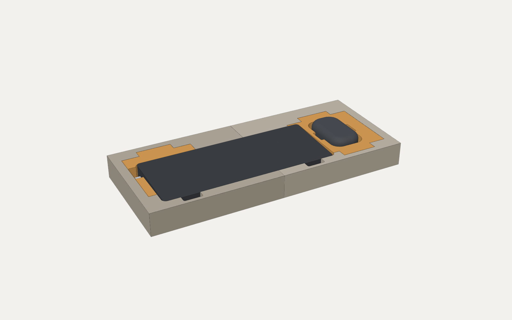
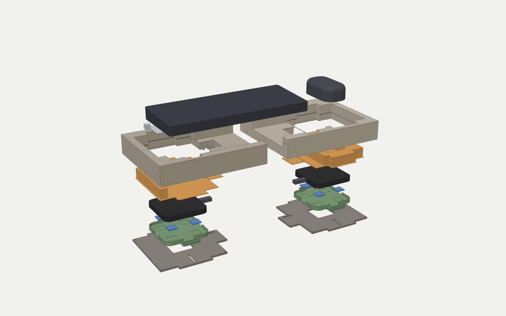
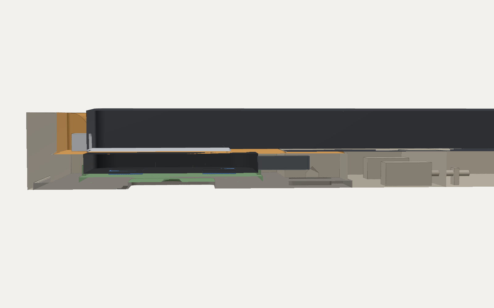

# Night Array pocket section: proof of concept

This is a printable test piece of the Night Array desk base: one tray with the **keyboard pocket** and the **mouse pocket**. You drop the devices in and they charge wirelessly through a **solid 1.0 mm resin floor** from two Anker 313 pads underneath.

It is built for function, not looks, and every part prints on a **Formlabs Form 4** in standard Formlabs resins. It answers one question before anyone prints the real base: **do your keyboard and mouse charge reliably through 1 mm of printed floor, and where exactly do the coils need to sit?**



**Quick start:** (1) print `coupon.stl` and do Test A; (2) if both devices charge through it, print everything in the table under *Printing on the Form 4*; (3) wash and fully post-cure; (4) follow *Assembly*; (5) tune with Test B.

| | |
|---|---|
| Tray | **487 × 205 × 44 mm** (W × D × H), plus about 1.8 mm of rubber feet |
| Devices | Keychron K3 Ultra 8K with a NILLKIN Magic Tag Type-C Short; Lenovo Multi-Device Wireless Mouse X9 Edition |
| Chargers | 2 × Anker 313 Wireless Charger (Pad) A2503, used intact |
| Printer | **Formlabs Form 4** (200 × 125 × 210 mm). Every part fits inside 190 × 115 × 195 mm in some orientation, leaving room for supports and the raft (the script checks this). |
| Resin | about **1.9 L** in total (the tray pieces are hollowed from underneath); see the table below |

`pocket_section.py` generates everything. All dimensions are named, commented parameters at the top of the script. Run it with the CadQuery venv:

```
night-array/cad/.venv/bin/python night-array/kit/poc/pocket_section.py              # STLs + checks + preview renders
night-array/cad/.venv/bin/python night-array/kit/poc/pocket_section.py --no-render
```

It writes the STLs to `print/` (mm, Z-up, flat face down, centred on the origin) with `print/print-list.json`, and the preview renders to `preview/`. It also checks the assembly, writes the results to `build/checks.json`, and exits non-zero if any check fails.

## Printing on the Form 4

| File | Qty | Size (mm) | Resin | mL each | How to place it in PreForm |
|---|---:|---|---|---:|---|
| `tray_front_left.stl` | 1 | 190 × 102 × 44 | Grey V5 (or Rigid 4000 for extra stiffness) | 219 | top (pocket side) up, tilted ~15-20 deg; supports on the hollow underside only |
| `tray_front_middle.stl` | 1 | 107 × 102 × 44 | Grey V5 (or Rigid 4000 for extra stiffness) | 143 | top (pocket side) up, tilted ~15-20 deg; supports on the hollow underside only |
| `tray_front_right.stl` | 1 | 190 × 102 × 44 | Grey V5 (or Rigid 4000 for extra stiffness) | 209 | top (pocket side) up, tilted ~15-20 deg; supports on the hollow underside only |
| `tray_back_left.stl` | 1 | 190 × 103 × 44 | Grey V5 (or Rigid 4000 for extra stiffness) | 278 | top (pocket side) up, tilted ~15-20 deg; supports on the hollow underside only |
| `tray_back_middle.stl` | 1 | 107 × 103 × 44 | Grey V5 (or Rigid 4000 for extra stiffness) | 183 | top (pocket side) up, tilted ~15-20 deg; supports on the hollow underside only |
| `tray_back_right.stl` | 1 | 190 × 103 × 44 | Grey V5 (or Rigid 4000 for extra stiffness) | 327 | top (pocket side) up, tilted ~15-20 deg; supports on the hollow underside only |
| `kb_floor_block.stl` | 1 | 167 × 165 × 24 | Grey V5 | 109 | 1.0 mm floor top face UP, tilted ~20 deg; NO supports on the floor top or pocket faces |
| `mouse_floor_block.stl` | 1 | 167 × 165 × 24 | Grey V5 | 180 | 1.0 mm floor top face UP, tilted ~20 deg; NO supports on the floor top or pocket faces |
| `pad_carrier.stl` | 2 | 105 × 137 × 9 | Tough 2000 V2 | 40 | base underside toward the platform, tilted; supports on the underside |
| `kb_hatch.stl` | 1 | 184 × 174 × 4 | Grey V5 (or Tough 1000) | 97 | standing on a long edge or tilted; supports on the inside face |
| `mouse_hatch.stl` | 1 | 184 × 174 × 4 | Grey V5 (or Tough 1000) | 97 | standing on a long edge or tilted; supports on the inside face |
| `dowel_pin.stl` | 11 | 3 × 3 × 13 | Tough 2000 V2 | 0 | standing or flat; print a few spares (count includes 4) |
| `coupon.stl` | 1 | 110 × 110 × 4 | Grey V5 | 13 | 1.0 mm plate top face up, tilted; supports on the skirt side only |

Total about **1936 mL** of resin. PreForm adds supports and shows the real volume and time; its numbers win.

- **Print the coupon first** and run Test A below before anything else.
- **The tray** is 6 pieces (front/back × left/middle/right) because the Form 4 can't print the 487 mm tray whole. Each piece is hollowed from underneath with a waffle of ribs, so no resin gets trapped. Place each one pocket-side up, tilted 15–20°, with supports only on the hollow underside, never on the pocket floors, coves or rim.
- **Keep supports off the charging floors.** On the two floor blocks and the coupon, the 1.0 mm floor's top face must be support-free: a support nub there lifts the device off the charger.
- **Wash and fully post-cure** every part (Form Wash, then Form Cure at the resin's recommended time and temperature). Full cure matters here: the pads run around 40 °C.
- **Materials:** use the resins in the table, or any of your standard Formlabs resins. Avoid ESD or metal-filled resins anywhere near the pads; they can block charging.
- **Fits** are set for resin (0.25 mm per side between printed parts, 3.4 mm screw holes, press-fit M3 nut traps).
- Filament alternative: the same script can still make PETG parts for a filament printer (two tiles); ask if you switch.

### Joining the tray pieces

- Push printed **dowel pins** (`dowel_pin.stl`, 3 × 13 mm) into the holes on each seam face, dry-fit all six pieces upside down on a flat surface, then **glue the seams** (5-minute epoxy, CA glue, or a thin bead of resin cured with a UV torch).
- The two **hatches** screw on across the front/back seam and the **floor blocks** sit across it too, so they hold the pieces in line from below and above.
- Not every seam has a dowel (they only go where both sides are solid); the glue does the real work.

## How it works



- **Six pieces** form the tray (front/back × left/middle/right, up to 190 × 103 × 44 mm each), glued along the seams with printed dowel pins for alignment.
  - The left/middle and middle/right seams run between the two charging areas. The front/back seam crosses both pockets; the floor blocks above it and the hatches below it bridge it.
  - No seam crosses a 1 mm charging floor (those are in the separate floor blocks).
- **Two floor blocks**, one over each pad (orange in the renders).
  - Keeping the 1.0 mm floor in its own part means it can be printed with no supports on its top face, so it comes out flat and exact. The part of the tray directly above each pad cavity is that separate block.
  - That underside **is** the charging floor: flat and exactly 1.0 mm thick wherever the pad can reach.
  - The block drops into a 45° tapered seat in the tray **from below**. The pad pushes it up into the seat, and its top sits flush with the rim.
  - Each block carries its share of the pocket walls and rim. You will see a hairline seam in the pocket floor and rim. That is expected.
- **Two pad carriers** (identical parts).
  - Each holds an Anker 313 in short corner walls, with a gap in the middle of every side for the micro-USB plug and the LED light.
  - The pad sits on **four 20 × 20 mm squares of 3 mm foam**, squeezed to 2 mm, which press its top face against the underside of the 1.0 mm floor.
  - Each carrier slides **±15 mm in x (left/right) and ±15 mm in y (front/back)** inside its cavity.
- **Two hatches** close the cavities from below with 4 × M3 each, into nuts pressed into the tray. Each hatch has:
  - **Two lock slots.** The lock screws come up through each hatch slot (running front to back) and the carrier slot (running left to right) into a captive nut on the carrier's ear. Where the two slots cross, one screw locks both directions.
  - **A 50 × 50 mm finger window.** Push the carrier with a fingertip on the cone dimple under its centre.
  - **A tick scale** engraved round the window, every 5 mm from −15 to +15. The dimple shows where the pad sits.
  - **An LED sight slot** in the plug bay.
- **Underside.** Each pad cable runs from its plug bay to the back edge in a groove with a peaked roof, so it prints without supports. There are 8 pockets for 10 mm rubber bumpers.

### Floor stack, from the underside up (z = 0 is the tray underside)

| z (mm) | |
|---|---|
| 0 – 4 | hatch (flush in a recess) |
| 4 – 7 | carrier base |
| 7 – 9 | foam (3 mm, squeezed to 2) |
| 9 – 20.2 | Anker 313 pad (11.2) |
| **20.2 – 21.2** | **1.0 mm solid resin floor**, the underside of the floor block |
| 21.2 | where the keyboard feet and the mouse rest |
| 44 | rim. The K3 Ultra's keycaps sit 2.8 mm below it at the front and 2.7 mm above it at the back. The mouse stands 11 mm proud, so it's easy to grab. |



## Hardware

| Item | Qty | Use |
|---|---|---|
| M3 × 8 button head (ISO 7380) or socket head | 12 | 8 hatch screws (4 per hatch), 4 carrier lock screws |
| M3 washer (7 mm OD) | 4 | under the lock-screw heads |
| Glue for the tray seams | — | 5-minute epoxy or CA glue (or resin + a UV torch) |
| M3 hex nut | 12 | 8 hatch nut traps, 4 carrier ears |
| 3 mm EVA craft foam (plus a little double-sided tape or glue) or 3 mm foam tape | 8 squares, 20 × 20 mm | under the pads, 4 per carrier |
| Self-adhesive rubber bumpers, about 10 mm Ø × 3 mm | 8 | feet |
| Micro-USB cable | 2 | one comes with each Anker 313 (4 ft). A right-angle plug is optional; the plug bays fit a straight one. |
| USB charger with **two ports that each give 5 V / 2 A** | 1 | Anker: computer USB ports are *not* enough |
| *Optional:* flexible ferrite sheet, 0.1–0.3 mm, at least 85 × 50 mm | 1 | only if the keyboard pad blinks for metal (see below) |
| Tools | | 2 mm hex key, a small flat file or sandpaper, calipers if you have them |

Steel and the pads: every screw and nut is at least **10 mm** in plan from where the pad can be at any carrier position (the script checks this; the closest is 10.0–10.2 mm). Nothing metal sits above the pads.

## Assembly

Do everything **with the tray upside down on a towel**. That way the nuts drop into place and the floor blocks stay in their seats.

1. **Clean up the prints.**
   - Remove the supports and sand any support nubs flat, especially on the floor blocks' tapered flanges and the tray pieces' seat openings.
   - A block must drop into its seat and sit with its top flush with the rim, without forcing. If it binds, file the 45° flange lightly.
2. **Join the six tray pieces.**
   - Push the printed dowel pins into the seam holes.
   - Dry-fit all six pieces upside down on a flat table, then glue each seam and clamp or tape it until set. Check the rim is flat across the seams.
3. **Fit the hatch nuts.** Press an M3 nut into each of the 8 hex traps around the two cavities, 4 per cavity. Seat them with a screw if needed.
4. **Fit the floor blocks.** Drop the keyboard block and the mouse block into their seats. The keyboard block is the one with the Magic Tag notch.
5. **Fit the pads.**
   - Lay each Anker pad **top face down** onto its block's underside.
   - Point the micro-USB edge toward the plug bay. On the keyboard pad that is toward the tray's right. On the mouse pad it is toward the keyboard pocket, to the left.
   - Plug in the cable. Lead it out of the bay through the groove to the back edge.
6. **Fit the carriers.**
   - Stick 4 foam squares onto the marked squares on each carrier.
   - Slide an M3 nut into each ear channel from its open end.
   - Lower the carrier over the back of the pad, foam onto the pad and corner walls round it, with the ears pointing to the front and back. Centre it: the dimple goes in the middle of the finger window.
7. **Fit the hatches.**
   - Each hatch fits one way only.
   - Fit 4 × M3 × 8 screws into the hatch nuts, plus 2 lock screws with washers up through the lock slots into the carrier nuts.
   - Leave the lock screws **loose** for now.
8. **Finish the outside.**
   - Stick the 8 rubber bumpers into the foot pockets.
   - Turn the tray over.
   - Plug both cables into the 5 V/2 A charger.

## Test procedure

### Test A: the coupon (do this before printing anything else)

1. Measure the coupon's plate with calipers. It should be **1.00 ± 0.05 mm**. If it's thicker, check that no support nub is left on the top face, and that the part was fully washed and cured.
2. Plug an Anker 313 into one 5 V/2 A port and put it on the desk.
   - The LED shows **solid blue for about 3 s and then goes off**.
   - **Flashing green** means the adapter or cable is not good enough.
3. **Baseline, no coupon.**
   - Put the X9 mouse directly on the pad. The pad LED should go solid blue, and the mouse's battery LED should show charging.
   - Then try the keyboard:
     - Plug the Magic Tag into the K3 Ultra's left USB-C and fold it flat underneath.
     - Fold the flip-out feet **in**.
     - Set the keyboard so the receiver is over the pad.
     - Prop the keyboard's far end on something about 12 mm thick so it lies level.
4. **Through the coupon.** Repeat step 3 with the coupon over the pad, skirt down round the pad. Both devices should charge as they did in the baseline.
5. **Margin check (worth doing).** Add one business card (about 0.3 mm) on top of the coupon. If charging still starts every time, you have margin.
6. **Note where the receivers are.**
   - Slide each device around on the coupon and note where charging starts and where it stops. The centre of that area is the coil.
   - For the keyboard, note how far the coil is from the keyboard's **left edge** and from its **rear edge**. The design assumes 48 mm and 38 mm, and covers 33–63 mm and 23–53 mm.
   - If yours is outside that range, change `TAG_COIL_FROM_LEFT` or `TAG_COIL_FROM_REAR` (or `MOUSE_COIL_DX` and `MOUSE_COIL_DY`) and re-run the script before printing.

If a device will not charge through the coupon at all, don't print the tray yet. Read "If it doesn't charge" below.

### Test B: tuning the carriers in the tray

1. Put the device in its pocket.
   - **Keyboard:** Magic Tag fitted, plug and fold in the notch on the left, flip-out feet folded in.
2. Get at the hatch.
   - Slide the tray so that pocket's end overhangs the table edge by about 19 cm.
   - Keep a hand or a book on the other end.
3. Loosen the two lock screws of that hatch by about half a turn. The carrier should slide but not flop.
4. Find the sweet spot.
   - With a fingertip on the carrier's dimple in the finger window, move the carrier around slowly, about 5 mm at a time.
   - Watch the device's charging indicator and the blue glow in the LED sight slot. You can often also see the glow through the 1 mm floor beside the device.
   - Solid blue and the device charging means good.
   - Find the area where charging starts and stays on, then put the dimple in its **middle**. Read the position off the tick scale.
5. Tighten both lock screws. Lift the device out and put it back about ten times. It must start charging every time.
6. Write down the final offsets, for example "kb x +5, y −10". The real base will use them for its fixed coil positions.

### If it doesn't charge

- **The pad blinks blue when the keyboard is in place** (foreign object detected).
  - The K3 Ultra has an aluminium plate and frame over the receiver, which can trip the pad's metal detection.
  - Fit a thin **flexible ferrite sheet** between the Magic Tag pad and the keyboard's underside. It fits in the 2 mm foot gap.
  - Also check that no screw, coin or clip is near the pocket, and try moving the carrier a few mm.
- **Charging starts and stops.** Most likely the receiver is near the edge of the coil.
  - Retune per Test B.
  - Check the pad is pressed up against the floor. Push up through the finger window: the carrier should spring back.
  - If not, stack a little more foam.
- **It charges on the coupon but not in the tray.** Check that the pad is the right way up (top face against the floor) and that the floor block is fully seated.
- **The pad gets hot or cuts out.** Anker sets a 40 °C maximum ambient (25 °C or below for full speed). Leave the finger windows open, and keep the tray away from heat sources and chargers.

## What's uncertain (and why the carriers slide)

- **Keyboard receiver position.** This is an **estimate**.
  - The verified research puts the Magic Tag's coil about 45–55 mm from the K3 Ultra's left edge.
  - From the rear edge it is about 23 mm if the pad lies on the USB-C port line, or about 45–50 mm after a 45° fold to clear the rear-left foot. All of these numbers were scaled from product images.
  - The design centres on 48 mm × 38 mm and covers ±15 mm. Test A confirms it.
- **Mouse receiver position.** The X9's coil position is **not published**. The design assumes the middle of the mouse, ±15 mm.
- **Magic Tag thickness.** Unpublished; about 1 mm assumed. It lies in the keyboard's 2 mm foot gap. The plug and fold relief is 11 mm deep (the user measured 8–10 mm sticking out) and 34 mm long, centred on the port about 23 mm from the rear edge (estimated).
- **Anker 313 details.** These are estimated:
  - corner radius about 14 mm;
  - micro-USB assumed in the middle of one edge at mid-height;
  - the exact spot of the status LED on the pad.

  The carrier's open wall gaps and the sight slot are there because of that last point.
- **Printed fits.** Fits are set for resin: 0.25 mm per side at the floor-block seats and hatches, 0.5 mm round each pad in its carrier, 3.4 mm M3 clearance holes and press-fit nut traps. The keyboard has 2.5 mm per side in its pocket, the mouse 3 mm. Each pocket wall rises straight for 6 mm (so the devices land over the chargers), then a concave, bowl-shaped cove curves up to the rim, 12 mm wider per side at the top (`POCKET_STRAIGHT`, `POCKET_FLARE`), and the Magic Tag notch is 14 mm deep and 37 mm long. If parts come out tight or loose, change `FIT`, `HATCH_FIT`, `KB_CLR` and `MOUSE_CLR` at the top of `pocket_section.py` and run it again.
- **Unsupported floor.** The 1 mm floor is unsupported where the cavity is wider than the pad (galleries and plug bay). One of the keyboard's front-left feet can land on such a span. It will flex a few tenths of a millimetre, which is harmless here.

## What the script checks (`build/checks.json`)

- **Meshes.** Every STL is watertight and consistently oriented, has a positive volume and fits the Form 4 (inside 190 × 115 × 195 mm in some orientation).
- **Devices.** The keyboard, Magic Tag (plug, fold and pad) and mouse envelopes don't touch the tray. With the keyboard grown by 0.9 mm and the mouse by 1.4 mm in plan, they still don't touch the walls.
- **Travel.** At all 9 corner and centre positions of the ±15 mm travel, the pad, plug and carrier don't intersect the tray, blocks or hatch. The pad top *touches* the floor block: raised 0.05 mm, it would cut into it.
- **Floor stack.** The block is solid from z 20.2 to 21.2 (**1.000 mm**) at the pad centre and on a 5 × 5 grid over the whole pad sweep.
- **Metal.** Every screw and nut keeps ≥ 10 mm in plan from the pad footprint at any carrier position.
- **Keycaps.** They sit within ±3 mm of the rim (−2.8 at the front, +2.7 at the back).

Preview renders: `preview/assembled.png`, `preview/exploded.png`, `preview/underside.png`, `preview/section.png` (a cut through the keyboard pad) and `preview/detail.png` (the keyboard carrier stack, exploded).

`render_preview.mjs` renders them with headless Chromium and three.js from `night-array/viewer/node_modules`.

## Relation to the full kit

- This is a stand-alone test piece. It reuses numbers from the verified parts research and from `night-array/cad/kit/purchased.py`, but does not change anything under `night-array/cad/`.
- The real base (`KIT_SPEC.md`) keeps the same rules:
  - 1.0 mm solid floor;
  - no metal within 10 mm of a pad;
  - pads in adjustable carriers;
  - per-device pocket fit.

  The offsets you record in Test B become its fixed coil positions.

## 3D explorer

`explorer/explorer.html` is an explodable, labelled 3D view of every part (published as a claude.ai artifact page; it loads three.js from jsDelivr). It reads `explorer/parts-<version>.json` (made by `explorer/make_data.py`), which bundles the assembled meshes from `build/` (written by `pocket_section.py`) with each part's name, description and print-list numbers. That file is generated, not committed.
