# Night Array light ribbon: optics study

The idea: software paints light on a band of the screen, a concealed mirror redirects it, and a satin channel under the display shows it as a soft ribbon. No LEDs, no controller, no moving parts.

This folder checks whether that works, with a small ray tracer, before anyone renders or builds it. **It does, with one change to where the mirror goes.**

| | Ribbon, white band | Ribbon height | Optics volume (deep × tall) | Screen content leaking into the ribbon |
|---|---|---|---|---|
| As drawn: open band, mirror on the base | 4.5 nits | 43 mm | 114 × 160 mm | yes |
| As drawn: open band, mirror on a lip 95 mm out front | 22 nits | 47 mm | 138 × 136 mm | yes |
| No mirror: band reflecting in a satin deck | 10 nits | 37 mm | the deck | yes, strongly |
| **Sill periscope (proposed)** | **64 nits** | 27 mm | **33 × 71 mm** | none |

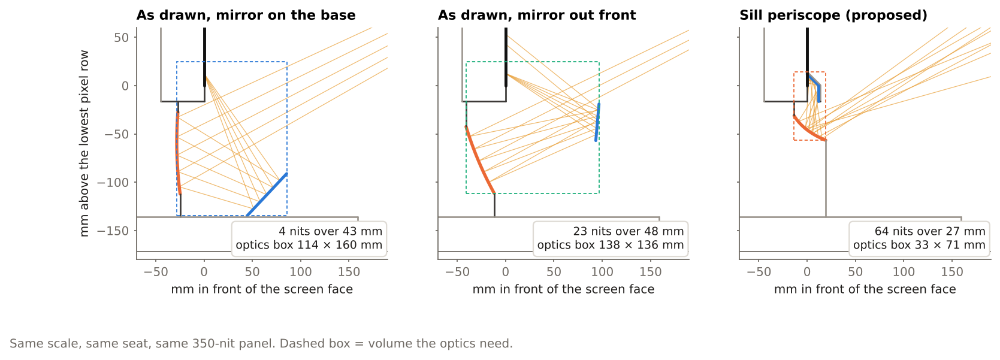

Numbers are for a 350-nit panel showing white, seen from a seat 650 mm from the screen with the eyes 280 mm above the lowest pixel row.

## Why the drawn layout is dim, and why it grows

A monitor is brightest straight ahead. Measured IPS panels give about 43 % of their on-axis luminance at 45° and 24 % at 60°. A mirror below the display can only catch light that leaves the screen heading steeply down, and the closer the mirror sits to the display the steeper that angle: 63° for a mirror on the base. Moving the mirror forward improves the angle (28° for a lip 95 mm out) but takes the space in front of the screen. In both cases the mirror also faces the rest of the screen, so whatever is in your windows leaks into the ribbon.

## The sill periscope

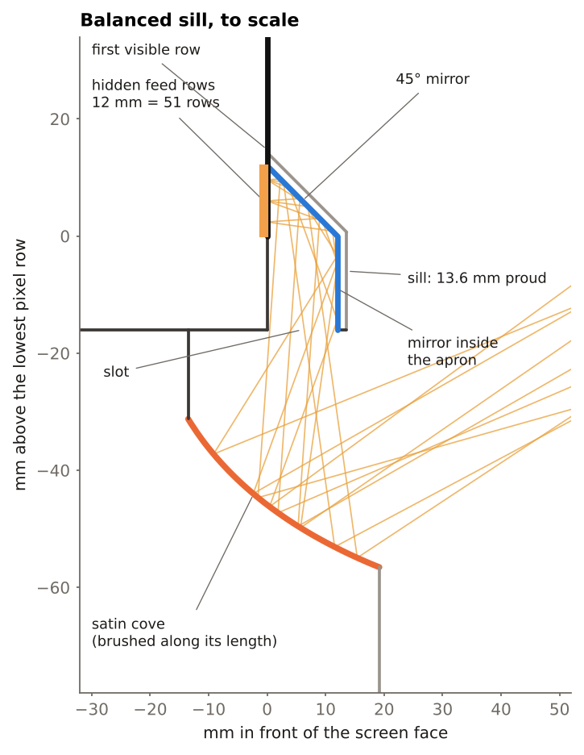

1. **Hidden feed rows.** The lowest 12 mm of both panels (51 rows) sit behind a slim sill. With the sill's wall, 63 of 1440 rows are given up (4.4 %). The visible band in the concept picture can stay as decoration above the sill; it no longer feeds the ribbon.
2. **45° mirror inside the sill.** It sits 0 to 12 mm in front of the pixels, takes the light the panel emits best, and turns it straight down through a slot in front of the panel's chin. The sill stands 13.6 mm proud of the screen.
3. **Mirror on the inside of the sill's front wall.** It folds forward-going light back under the display. Without it the ribbon loses about a fifth.
4. **Brushed cove.** Its profile is an ellipse with the slot at one focus and the seated eyes at the other, so the whole surface lights at once. A flat ramp gives the same brightness in a ribbon half as tall. The brushing runs along the cove: that keeps the pattern sharp sideways and soft vertically.

Three presets trade ribbon height for size:

| Preset | Feed band | Rows given up | Ribbon (brushed / finer brush) | Ribbon height | Optics volume | Sill proud |
|---|---|---|---|---|---|---|
| Slim | 9 mm | 50 (3.5 %) | 65 / 90 nits | 17 mm | 23 × 56 mm | 10.6 mm |
| Balanced | 12 mm | 63 (4.4 %) | 64 / 88 nits | 27 mm | 33 × 71 mm | 13.6 mm |
| Tall | 16 mm | 80 (5.6 %) | 56 / 83 nits | 45 mm | 54 × 100 mm | 17.6 mm |

## Daylight

The ribbon competes with room light landing on the same cove, so luminance decides what survives daylight, not saturation. Amber carries half of white's luminance; deep oxblood under a tenth.

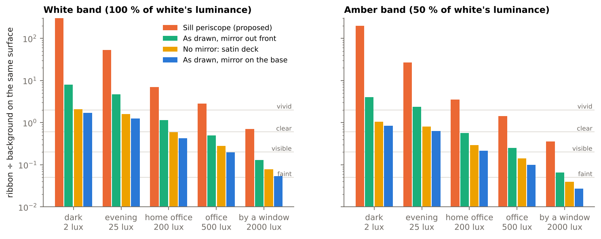

For the balanced preset with the measured brushed finish:

| Room | White | Amber | Rose | Oxblood |
|---|---|---|---|---|
| Evening, 25 lux | vivid (53×) | vivid (27×) | vivid (14×) | vivid (4×) |
| Home office, 200 lux | vivid (7×) | vivid (3.5×) | clear (1.9×) | visible (0.5×) |
| Office, 500 lux | vivid (2.8×) | clear (1.4×) | clear (0.8×) | visible (0.2×) |
| By a window, 2000 lux | clear (0.7×) | visible (0.4×) | faint (0.2×) | faint (0.05×) |

The figure in brackets is ribbon luminance divided by the cove's own luminance without it. The tier names are a judgement call for a large, soft, coloured patch (under 0.05× invisible, to 0.2× faint, to 0.6× visible, to 2× clear, above that vivid).

## Other findings

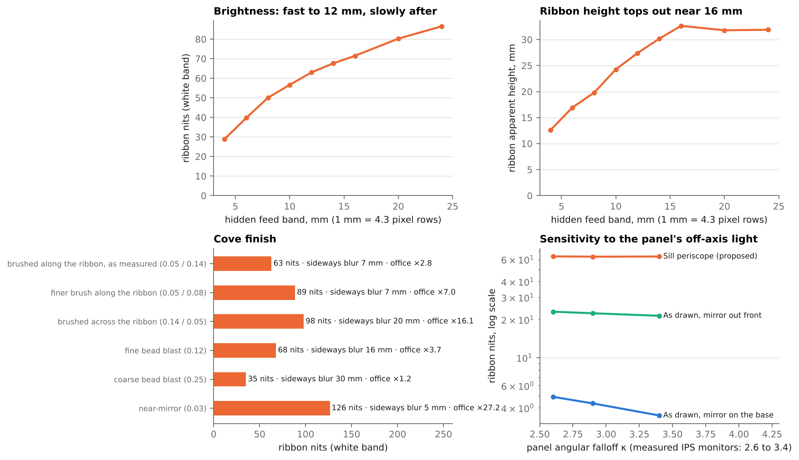

- **Screen area.** Brightness climbs quickly up to about 12 mm of feed band and slowly after. Ribbon height stops growing near 16 mm unless the cove also moves lower.
- **Finish.** Roughness along the ribbon sets how sharp the pattern stays sideways; roughness across it sets brightness and contrast. A finer brush across the grain is 38 % brighter and holds 2.4× the office-light contrast, at the cost of the far corners of the seat range and a look that is closer to a reflection than a glow. Bead-blast loses on both counts. Only the first row has measured roughness behind it.
- **Seat position.** The balanced ribbon holds 50 to 63 nits around the design seat. It falls as the eyes rise and move in, to about 19 nits standing close (eyes 460 mm above the lowest row, 450 mm away).
- **What it can show.** Sideways blur is 7 mm at the centre and 12 mm at the ends, so colour and brightness along the ribbon come through in fine detail. Height within the band barely maps to height in the ribbon, so a wave shape has to come from motion along it. The seam shows as a soft notch, and on a flat pair of panels the outer 45 mm of each end fade.
- **Robustness.** Mirror angle errors of ±4° change brightness by under 6 %. A 24 mm chin instead of 16 mm changes it by under 2 %. Across the measured range of panel angular falloff the sill result moves by under 1 %; the as-drawn base-mirror result moves by 29 %.

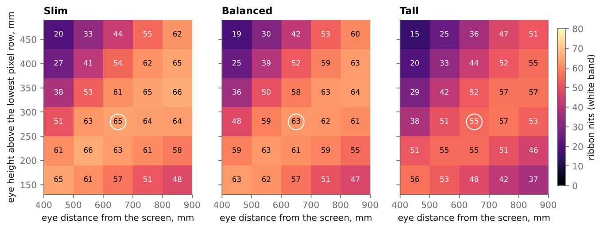

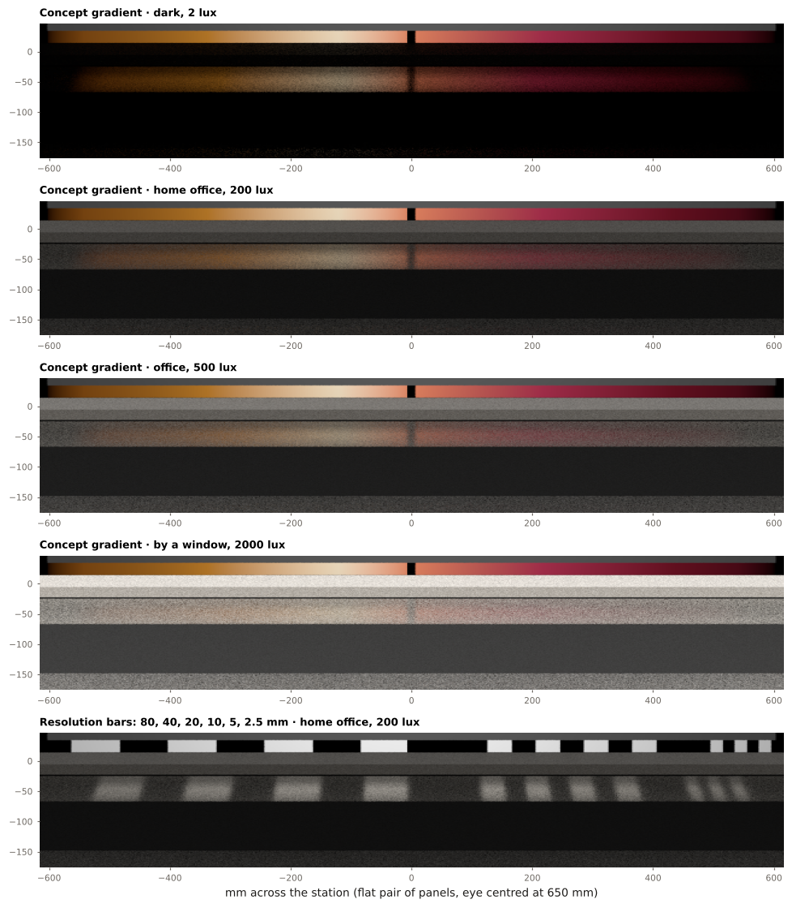

The strips are traced directly (flat pair of panels, eye centred) and tone-mapped so the panel's white is display white. [`page/light-ribbon.html`](page/light-ribbon.html) is an interactive version: an animated ribbon under selectable room light, pattern, layout and finish.

## Ray-traced render

[`render/`](render/) builds the station with these optics in Blender and path-traces it with Cycles: Balanced preset, finer brush. The brushed cove runs on over a rounded lip into a raked wall that lands on the base deck, so the cove is the stand.

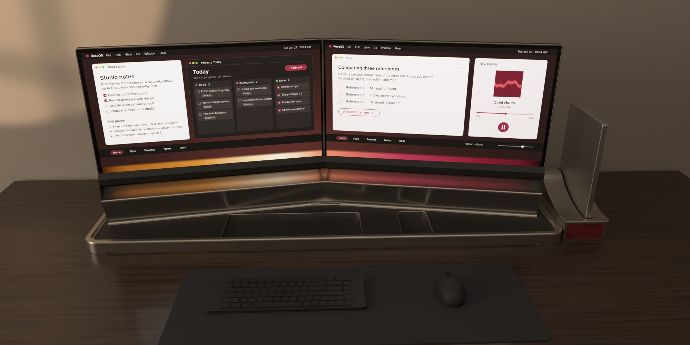

| | |
|---|---|
| 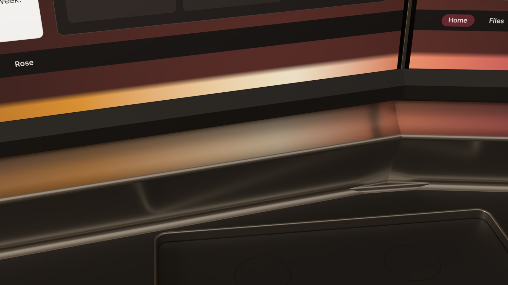 | 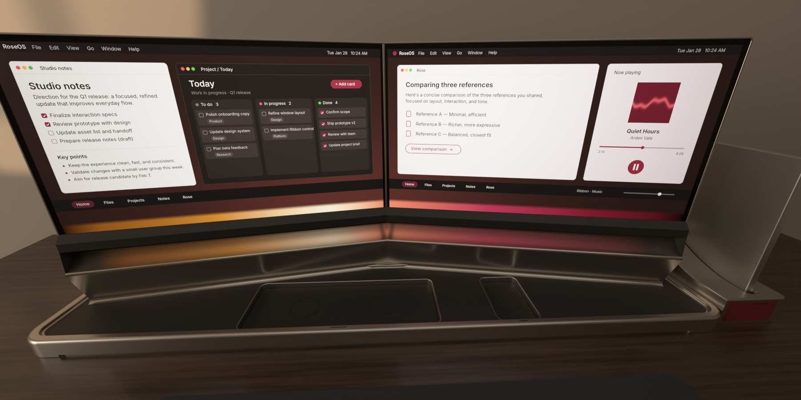 |
| Sill, ribbon and stand, left of the seam | From the seated eye, very wide lens |
| 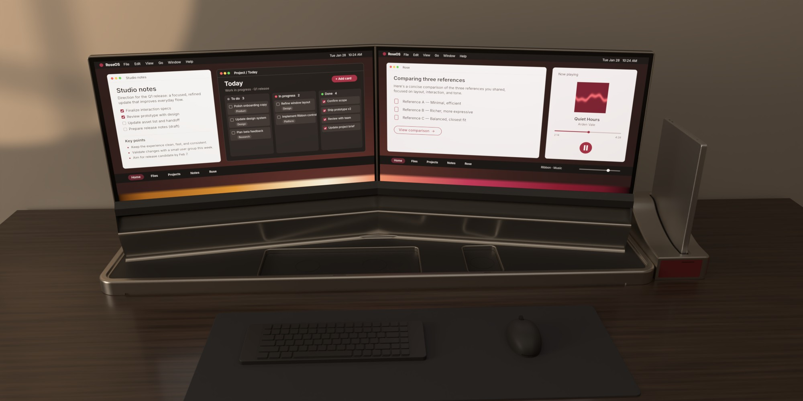 | 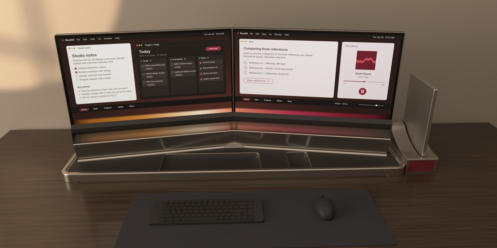 |
| Same frame with the feed rows black | Office light, 500 lux |

- **It agrees with the study.** With a white band the render puts 81.5 nits on the ribbon from the seat; the study's tracer predicts 81.2 for the same eye and the same spot on the panel. The two share the cross-section in `ribbon/designs.py` and nothing else.
- **Light groups.** One render holds the feed rows, the rest of the screen and the room as separate passes (`render/scene.py`), so `render/make_images.py` sets the room's lux, the exposure and ribbon on/off afterwards. `render/out/index.html` is a small gallery with those switches.
- **The stand.** The wall is raked back 22° and meets the deck 2 mm in front of the screen plane. It runs the full width with no gap; the stowed keyboard and mouse clear it by 11 mm or more. No band light reaches it, so the ribbon numbers above are unchanged.
- **Choices made for the render.** The sill's outside is dark satin (in titanium its bevel outshone the ribbon beneath it). The amber LEDs are off. Keyboard and mouse are in the work pose.

```
pip install bpy OpenEXR oidn pillow          # Blender 5.2 as a Python module
python render/screen_ui.py work              # the RoseOS desktop and the feed-row pattern
python render/scene.py --view probe --out work --samples 512
python render/scene.py --view hero --out work --samples 400 --width 2000      # also: detail, seat, front
python render/scene.py --view calib --out work --samples 300 --width 600 --band band_white.png
python render/make_images.py work            # render/out/*.jpg and the gallery
```

## 3D model

[`viewer/ribbon-3d.html`](viewer/ribbon-3d.html) is the same geometry as the render in a real-time orbit viewer (three.js, one self-contained file: open it in a browser). It has view presets, a cut-away to see the hidden rows, mirrors and slot, and the ribbon drawn as a live reflection of the slot in the cove, so it brightens and fades with the viewpoint. It is not ray traced and its brightness is not to scale.

```
python render/scene.py --out work --export viewer/assets/station-ribbon.glb     # the model, from the render scene
cd viewer && npm install && node build.mjs                                     # viewer/ribbon-3d.html
```

## What this rests on

- **Tracer.** Rays are followed backward from the eye through the mirrors and a GGX microfacet model of the satin surface to the panel or the room (`ribbon/trace.py`). `python -m ribbon.checks` compares it with closed-form cases and with an independent forward photon count of the sill layout; the two agree within 3 %.
- **Panel.** Samsung S60UD, 350 nits typical (280 minimum, which scales every ribbon number by 0.8). Angular falloff `exp(κ(cos θ − 1))` with κ = 2.9, the form fitted to two measured IPS monitors out to 60° (Zele et al., arXiv 2007.11151; κ 2.6 to 3.4). Beyond 60° it is an extrapolation.
- **Mirror.** 90 % reflectance, between acrylic mirror sheet (80 to 90 %) and enhanced aluminium (95 %).
- **Cove.** Roughness 0.05 along the brush and 0.14 across it, from fits to measured brushed aluminium (Ngan, Durand and Matusik 2005; Ward 1992), 60 % reflectance with a warm tint. No measured data was found for bead-blast, PVD or titanium finishes.
- **Room.** An evenly bright surround whose luminance gives the stated lux on the desk. A window or lamp aimed into the cove would do worse; a shaded desk better.
- **Not modelled.** Polarisation (the panel's light is polarised, direction unknown; expect a few percent either way off metal), and the 10° toe-in of the two panels (the preview is a flat pair).

## Run it

```
pip install -r requirements.txt
python -m ribbon.checks      # tracer checks, a few seconds
python run.py                # full study, about 10 minutes on 4 cores -> results/
python figures.py            # figures/*.png
python page/build.py         # page/light-ribbon.html
```

`ribbon/designs.py` holds every dimension of every layout. `ribbon/study.py` has the measurements (ribbon profile, contrast, sideways blur), `ribbon/preview.py` the strip renders and the shortcut the page uses.
