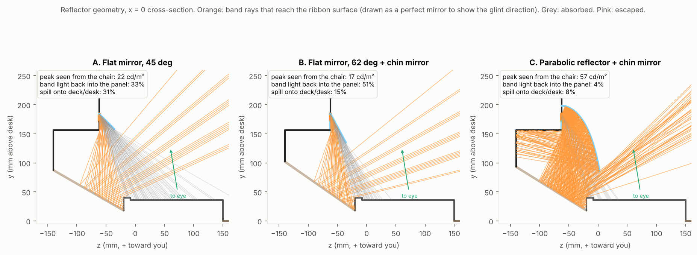
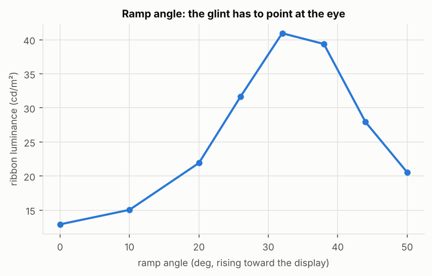
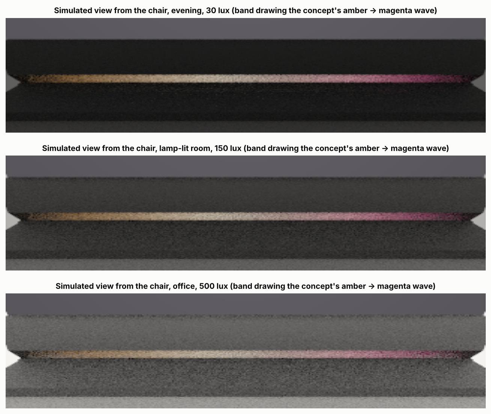
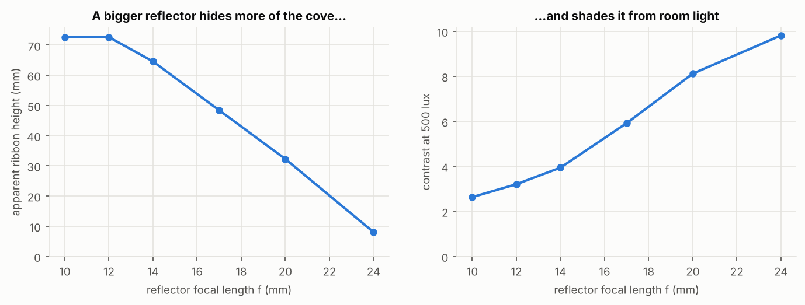
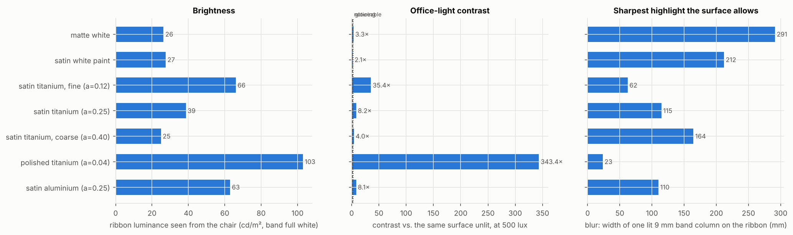
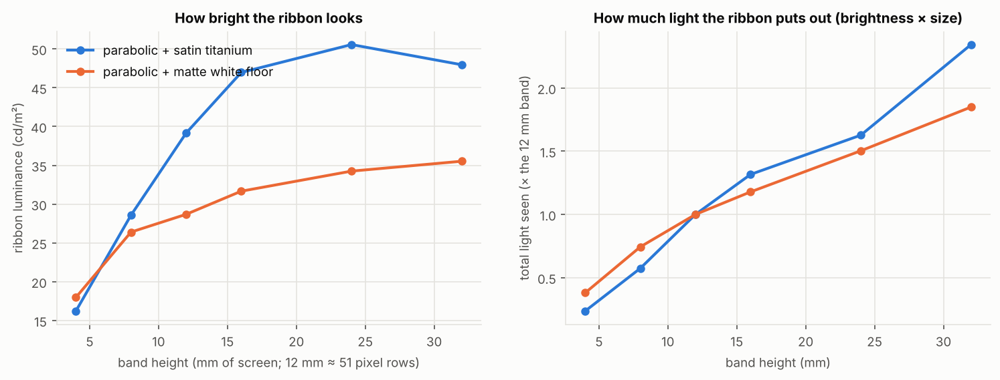
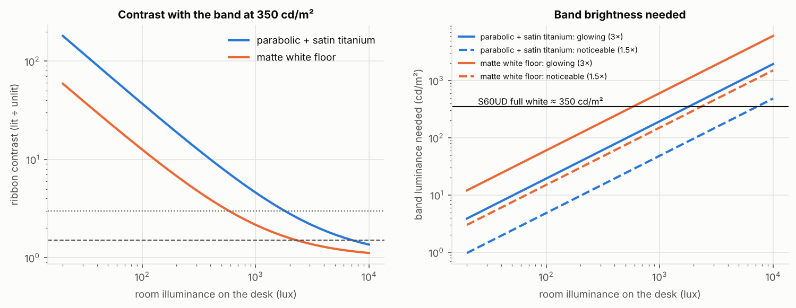
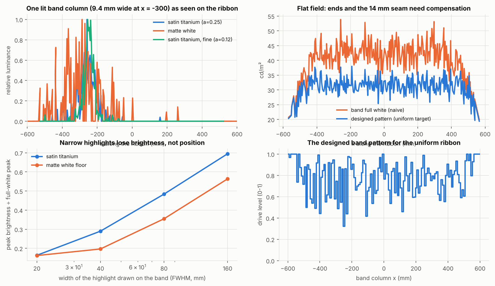
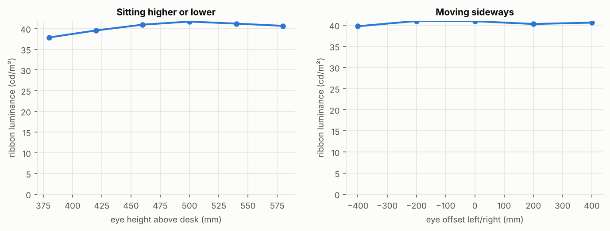

# Light ribbon: optics check

The light-ribbon idea: **software paints light, and the station gives it a physical surface.**
A band of pixels at the bottom of the screen shines into a hidden reflector. The reflector sends that light down into a recessed channel, where a satin surface spreads it into a ribbon. There are no LEDs, no lighting controller and no moving parts.

The concept render shows how it should *look*. This folder checks whether the optics can actually do it. It holds a small Monte Carlo ray tracer (Python, numpy only) for the Night Array cross-section, plus experiments that answer the open questions:

1. What reflector geometry works?
2. How much screen area gives enough light?
3. Is the ribbon visible in daylight?
4. What patterns can software actually draw on the ribbon?

```bash
pip install numpy matplotlib
python3 night-array/optics/test_tracer.py     # radiometry sanity checks
python3 night-array/optics/run.py             # all experiments → out/*.png + out/results.json (~11 min)
python3 night-array/optics/run.py --quick     # same, low sample counts (~1.5 min)
```

## Short answer

**It works, but only with a shaped reflector and a metallic satin surface aimed at the eye. A flat mirror under a matte floor doesn't work.** With the recommended design, a 12 mm band (about 51 pixel rows) at full white:

- looks about **40 cd/m²** from the chair;
- reaches about **8× contrast** against the unlit surface in a 500-lux office, and about 25× in a lamp-lit room;
- drops to about **1.7× (faint) in 5,000-lux daylight next to a window**.

What the optics *can't* do is the concept image's tall, soft wave. The ribbon reads as a **thin line of light, about 30 mm tall and 1.2 m wide**. The x-direction blur is about 115 mm, so "delicate highlights" become soft spots about 10 cm wide.

## Recommended geometry (design C)



| Part | Value |
|---|---|
| Light band | Bottom 12 mm of the active area (y 172–184, ≈ 51 rows), hidden behind the reflector |
| Reflector | **Off-axis parabolic trough**: focus on the band's centre line, focal length 20 mm, beam axis tilted **15° behind vertical**. It catches emission from straight up down to 55° below horizontal. First-surface protected aluminium (R ≈ 0.92). Outside (cap): graphite. |
| Chin | Mirror film on the 16 mm black chin below the band |
| Ribbon surface | A flat ramp rising toward the back at **32°**, from z = −20 (front lip) to z = −140 (back wall), finished **satin titanium** (bead-blast/brushed, GGX α ≈ 0.25) |
| Containment | Black back wall and display underside, graphite end caps and a low front lip |

Why the parabola matters: a flat mirror near the screen works like a corner reflector. Every ray the LCD emits upward is folded back into the panel. With a 45° flat mirror, 33% of the band's light goes back into the band and chin, and another 31% spills forward onto the deck. Steepening the flat mirror to 62° cuts the spill but sends 51% back into the panel. A parabola with its focus on the band turns the whole emission hemisphere into one beam aimed down and back under the display: 4% goes back into the panel and 8% spills.

| Design | Light back into panel | Spill onto deck/desk | Light reaching ribbon surface | Ribbon luminance (mean / peak) | Contrast at 500 lux |
|---|---|---|---|---|---|
| A. Flat mirror, 45° | 33 % | 31 % | 12 % | 13 / 22 cd/m² | 1.5× |
| B. Flat mirror, 62°, chin mirror | 51 % | 15 % | 11 % | 10 / 17 cd/m² | 1.3× |
| **C. Parabolic, chin mirror** | **4 %** | **8 %** | **40 %** | **39 / 57 cd/m²** | **8.2×** |

The ramp angle is set by the eye, not the reflector. It has to tilt so the glint (the beam's mirror direction) points at a seated eye about 460 mm above the desk and 710 mm from the glass. At 32° the ribbon is brightest; flatter or steeper ramps send the glint above or below the eye:



## What the ribbon looks like



These are path-traced views from the chair, with the band drawing an amber → white → magenta gradient like the concept. The dark band above the ribbon is the reflector's cap; the strip below is the front lip and deck.

The ribbon's apparent height is set by **the slot between the reflector's lower lip and the cove's front lip**, not by the ramp. Curving the ramp (concave or convex, tested up to ±20 mm of sag) didn't make the ribbon taller. A smaller reflector opens the slot, but the reflector is also the visor that keeps room light off the cove, so contrast falls:



| Focal length f | 10 mm | 14 mm | 17 mm | **20 mm** | 24 mm |
|---|---|---|---|---|---|
| Apparent ribbon height | 73 mm | 65 mm | 48 mm | **32 mm** | 8 mm |
| Contrast at 500 lux | 2.6× | 3.9× | 5.9× | **8.1×** | 9.8× |

## Surface finish



| Finish | Mean luminance | Contrast at 500 lux | Blur (width of one lit 9 mm column) |
|---|---|---|---|
| Matte white floor | 26 cd/m² | 3.3× | 290 mm |
| Satin white paint | 27 cd/m² | 2.1× | 210 mm |
| Satin titanium, fine (α 0.12) | 66 cd/m² | 35× | 60 mm |
| **Satin titanium (α 0.25)** | **39 cd/m²** | **8.2×** | **115 mm** |
| Satin titanium, coarse (α 0.40) | 25 cd/m² | 4.0× | 165 mm |
| Polished titanium (α 0.04) | 103 cd/m² | 340× | 25 mm |
| Satin aluminium (α 0.25) | 63 cd/m² | 8.1× | 110 mm |

A **metallic satin** beats any white surface on every measure. A white diffuser scatters light everywhere, so it is lit by the whole room and its ribbon is only a little brighter than its own ambient glow. A metallic satin surface, seen from the chair, reflects what is above it: the dark display underside and the reflector. It is dark when the band is off and bright when it is on. Main-screen content barely reaches the ribbon (spill is below 0.01 cd/m² per 100 cd/m² of content), because the reflector shades the cove from the screen too.

Roughness is the trade-off between brightness and softness:

- **Polished** surfaces show a sharp mirror image of the band. That is the brightest and highest-contrast option, but it no longer reads as a soft ribbon.
- **α ≈ 0.12–0.25 satin** gives the "glow" look. Pick fine satin for crisper highlights and better daylight performance; medium satin gives a softer look and more forgiving viewing positions.
- Aluminium is about 1.6× brighter than titanium at the same roughness and contrast. Titanium matches the station's finish.

## How much screen area



| Band height | 4 mm (17 rows) | 8 mm (34) | **12 mm (51)** | 16 mm (69) | 24 mm (103) | 32 mm (137) |
|---|---|---|---|---|---|---|
| Ribbon luminance, satin titanium | 16 | 29 | **39** | 47 | 51 | 48 cd/m² |
| Ribbon luminance, matte floor | 18 | 26 | 29 | 32 | 34 | 36 cd/m² |

Brightness rises up to about **16 mm (≈ 70 rows)** and then levels off. Beyond that, a taller band mostly makes the beam wider than the reflector can collimate. It adds some ribbon area but little brightness. **12–16 mm of the 335.7 mm active height (3.5–5 % of the screen) is the sweet spot.** The rows inside the reflector above the band (about 8 mm with f = 20 mm) must be kept black by the OS, so the screen loses roughly 20–24 mm in total.

## Daylight



These numbers use the band at the S60UD's typical full white of 350 cd/m², with the recommended design. "Noticeable" means 1.5× and "glowing" means 3×; both thresholds are judgement calls, not standards.

| Room | Contrast | Band luminance for "glowing" |
|---|---|---|
| Dim room, 50 lux | 73× | 10 cd/m² |
| Lamp-lit, 150 lux | 25× | 29 cd/m² |
| Office, 500 lux | 8.2× | 97 cd/m² |
| Bright office, 1,000 lux | 4.6× | 194 cd/m² |
| Next to a sunny window, 5,000 lux | 1.7× | 970 cd/m² (not reachable) |

The ribbon works at night and in normal offices with plenty of headroom. At night the band only needs about 3–10 % of full white, which makes low-light ambient modes easy. In direct daylight it fades to a faint line: a desktop LCD has no luminance headroom for that. The matte-white floor needs 3× more band luminance at every light level.

## What software can draw



- **Left–right (x) is controllable, but blurred.** A single lit column spreads to about 115 mm on the ribbon, mostly from the satin's roughness acting over the 100–150 mm throw. As a result:
  - broad bass "swells" (wider than about 150 mm) come through at most of their drawn brightness;
  - a 40 mm treble "highlight" reaches only about 30 % of full-white brightness, and a 20 mm one about 16 %;
  - highlights stay where they are drawn, but they get softer and dimmer.
  - Stereo panning (moving a broad blob left and right) works well.
- **Up–down cannot be steered.** All four row groups of the band land at the same height on the ribbon. The parabola collimates the band, so moving the pattern up or down the band changes the beam *angle*, not the spot's position. That only changes brightness slightly. Use the band's rows for brightness, not motion.
- **Pattern and optics have to be designed together.** `ribbon/analysis.py:design_pattern` solves for band drive levels that produce a target ribbon. It uses a constrained least-squares fit through the traced transfer matrix, which maps each band bin to each pixel the eye sees. The example evens out the ribbon: the ends are dimmer than the middle because of the end caps, so the solver drives the centre down to match them.
- **The seam.** The 14 mm pixel gap at x = 0 is much narrower than the ~115 mm blur, so it shows only as a shallow dip. The flat-field solve compensates for it.
- **Docking sweep / rest.** A sweep is a broad blob moving across x: well within reach. Off is black pixels: the cove then shows only reflected ambient light.

## Viewing position



The satin lobe makes the ribbon forgiving. From 380 to 580 mm eye height, and ±400 mm sideways, it stays within ±8 % of its centred value. A polished surface would not be this forgiving.

## The model and what it leaves out

- **Scene** (`ribbon/scene.py`): the Night Array cross-section at the seam, in SPEC.md's units and axes:
  - screen face at z = −62, active area from y = 172, 16 mm chin, base top at y = 36;
  - extruded 1,200 mm along x, with graphite end caps;
  - the cove is new geometry cut into the base between the display and the keyboard pocket;
  - eye at (0, 460, 650) mm.
- **Tracer** (`ribbon/tracer.py`):
  - backward path tracing from a pinhole eye: Lambert + GGX microfacet BRDFs, sampled with multiple importance sampling, and ideal specular mirrors;
  - IPS emission falls off as cos^0.7 θ;
  - three outputs in one pass, all linear in the sources: a transfer matrix from the band (128 × 4 bins) to every image pixel, the response to a uniform room (luminance = lux/π), and the response to main-screen content;
  - a forward tracer for the flux budget.
- **Checks**: `test_tracer.py` verifies Lambertian albedo, metal energy and that no BRDF gains energy.
- **Not modelled:**
  - the 10° toe-in of each panel (the real band and reflector follow the two facets and fold at the seam);
  - the neck (it blocks the cove behind the centre);
  - polarisation (LCD light is polarised, which can matter with polarised sunglasses and some coatings);
  - the panel's own reflection;
  - colour-dependent reflectance (titanium is slightly warm);
  - manufacturing tolerances on the parabola.
  - Ambient light is an idealised uniform room; a window, a desk lamp or a light above and behind the user will change the daylight numbers in either direction.
- **Next steps for a physical test:**
  - bend a 0.5 mm mirror-finish aluminium strip over a 3D-printed parabola former (f = 20 mm, 15° tilt);
  - bead-blast a titanium or aluminium coupon for the ramp;
  - display a 12 mm white bar on an S60UD and measure the ribbon with a luminance meter (or a phone camera at fixed exposure) at 50, 500 and 5,000 lux.
